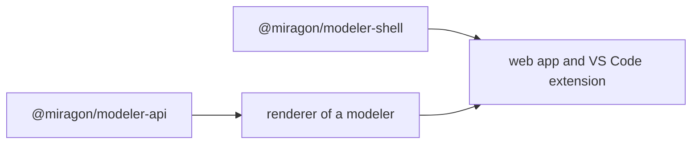

# Build from source

Run every modeler from the repository, for example to try Value Chain in the browser, or to work on the suite.

## Run a modeler

You need Node `^22.22.2 || >=24.15.0` and npm.

```sh
npm ci
npm run build:shared
npm run wardley-maps dev:webapp
```

Every modeler takes the same scripts: `npm run <modeler> <script>` with `build`, `test`, `test:browser`, `test:e2e`, `lint` and `dev:webapp`.

## How the suite fits together



Each renderer implements the [modeler API](/platform/api) and passes its conformance kit. Both apps of each modeler mount the [shell](/platform/shell), the chrome they share.

## Next steps

- [CI and releases](/ci-and-releases): workflows, publishing and versioning.
- [Contributing](https://github.com/Miragon/modeler-suite/blob/main/CONTRIBUTING.md)
