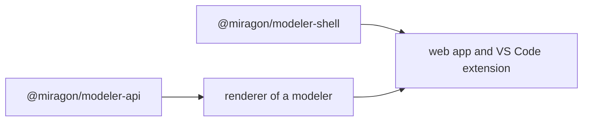

# Getting started

Every modeler of the suite runs as a web app, as a VS Code extension and as an npm library. To try one, open its web app from the [modelers](#the-modelers). To work on the suite, build it from the repository.

## The modelers

| Modeler                                      | Files                           |
| -------------------------------------------- | ------------------------------- |
| [Wardley Maps](/modelers/wardley-maps)       | `.wmap`, `.owm`                 |
| [Event Storming](/modelers/event-storming)   | `.storm`                        |
| [Team Topologies](/modelers/team-topologies) | `.tt`, `.ttm.json`              |
| [Context Maps](/modelers/context-maps)       | `.cm`, `.cm.json`, `.cml`       |
| [Value Chain](/modelers/value-chain)         | `.vc`, `.vc.json`               |
| [C4 model](/modelers/c4)                     | `.c4`, `.dsl` (Structurizr DSL) |

## Build from source

You need Node `^22.22.2 || >=24.15.0` and npm.

```sh
npm ci
npm run build:shared
npm run wardley-maps dev:webapp
```

Every modeler takes the same scripts: `npm run <modeler> <script>` with `build`, `test`, `test:browser`, `test:e2e`, `lint` and `dev:webapp`.

## How the suite fits together



Each renderer implements the [modeler API](/platform/api) and passes its conformance kit. Both apps of each modeler mount the [shell](/platform/shell), the chrome they share.

## Next steps

- [CI and releases](/ci-and-releases): workflows, publishing and versioning.
- [Contributing](https://github.com/Miragon/modeler-suite/blob/main/CONTRIBUTING.md)
