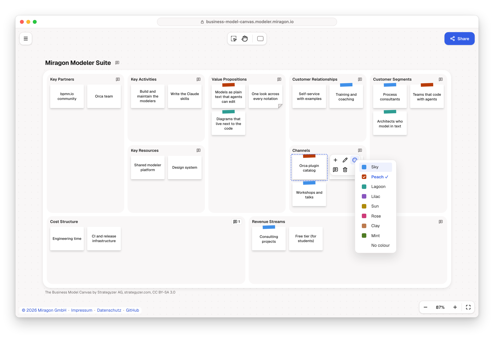

# Business Model Canvas Modeler

[](LICENSE)

Fill in a [Business Model Canvas](https://www.strategyzer.com/library/the-business-model-canvas):
the nine building blocks of a business model on one page, from the customer segments you serve to
the costs it takes. Every idea is a sticky, with a tape colour that means what your team makes
it mean, such as the customer segment it serves, and notes for what you still have to test. Each
canvas is a plain-text `.bmc` file, so it lives in your repository, shows up as a readable diff
and evolves with the plans it explains.

Free and open source (MIT). No account, and it works offline. Part of the
[Miragon modeler suite](../../README.md).



## Use it where you work

- **In the browser:** the web app needs no install (no public deployment yet; run it with
  `npm run business-model-canvas dev:webapp`). Open or drop a `.bmc` file. **Share** copies a link
  that holds the whole canvas. Export PNG, SVG or `.bmc`.
- **In VS Code:** the [Business Model Canvas Modeler](apps/vscode/README.md) opens `.bmc` files as
  canvases, with the text side by side and problems in the Problems view.
- **In Orca:** the [Orca plugin](apps/orca/README.md) shows each change your coding agent writes
  to the canvas as it happens.
- **With Claude Code:** the
  [`business-model-canvas-modeler` plugin](plugins/business-model-canvas-modeler/README.md) teaches
  Claude the method and the `.bmc` format, so it can draft a canvas from your notes or review one
  with feedback notes in the file.

Press `?` in any of them for every key and gesture.

## What you can draw

The nine blocks stand in the layout of the original canvas: Key Partners, Key Activities over Key
Resources, Value Propositions, Customer Relationships over Channels, Customer Segments, and Cost
Structure next to Revenue Streams. An empty block asks its question in a hint. Stickies flow in
the order of the file, and a block that fills up grows its whole row.

| Mark             | Means                                     |
| ---------------- | ----------------------------------------- |
| Tape in a colour | what the colour stands for on your canvas |
| Folded corner    | notes, on hover                           |

Every sticky is white paper. Select one and pick **Colour** in its context pad: one of eight
colours, shown as a strip of tape across its top edge, or no colour. A common way is one colour
per customer segment, on the segment and on every sticky that serves it. Click the title to edit
it in **Canvas title…**.

Notes go on a sticky, on a block or on the canvas as a whole: a remark, a question, an
assumption to test. Read and write them in the **Notes** panel. It opens from the comment
after the canvas title or at the end of a block heading, which shows how many notes that place
has, from **Notes** in a sticky's context pad or the menu, or with N. Hover a comment or a sticky
to read its notes. The comments stay out of every export. Write an assumption you still have to
test as a note on its sticky, such as "Assumption: hotels order every day".

## The `.bmc` file

The file is YAML. `canvas` holds the `title` and the `notes` on the canvas as a whole. Each building
block is a field holding its `items`, the stickies, each with an `id`, a `text` and optionally
`color` (its tape) and `notes`, and the block's own `notes`. Fields the modeler does not know stay.
Comments do not: the canvas writes the file anew from what it shows, so a remark goes into a note.
An excerpt of the example [`example/miragon.bmc`](example/miragon.bmc):

```yaml
version: 1
canvas:
  title: Miragon Modeler Suite
customer-segments:
  items:
    - id: consultants
      text: Process consultants
      color: sky
    - id: agent-teams
      text: Teams that code with agents
      color: peach
value-propositions:
  items:
    - id: plain-text-models
      text: Models as plain text that agents can edit
      color: peach
    - id: one-look
      text: One look across every notation
      notes:
        - text: Reason to switch, or nice to have?
```

The full format is in the
[`bmc-dsl` skill](plugins/business-model-canvas-modeler/skills/bmc-dsl/SKILL.md). The modeler
publishes no npm package: its libraries are bundled into the web app, the VS Code extension and
the Orca plugin. Building, running and testing the modeler is in [CONTRIBUTING.md](CONTRIBUTING.md).
Issues go to [Miragon/modeler-suite](https://github.com/Miragon/modeler-suite/issues).

## Licence

[MIT](LICENSE). The Business Model Canvas is by Strategyzer AG,
[strategyzer.com](https://www.strategyzer.com), licensed under
[CC BY-SA 3.0](https://creativecommons.org/licenses/by-sa/3.0/). Every canvas the modeler draws,
and every export of it, carries that line. The hints are Miragon's own, not the canvas's official
guiding questions, and the modeler draws none of its official artwork. This project is not
affiliated with or endorsed by Strategyzer AG.
