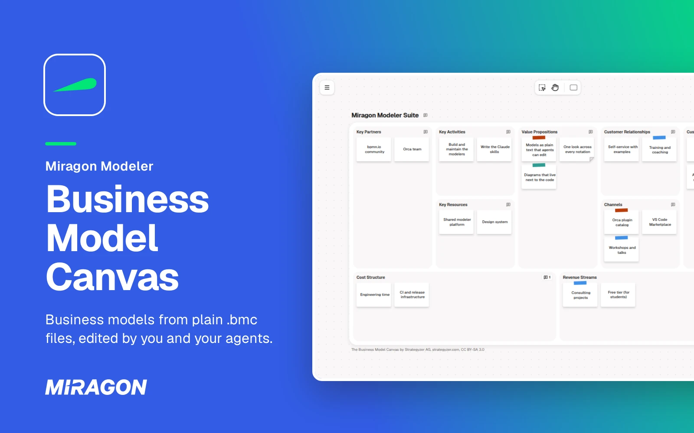
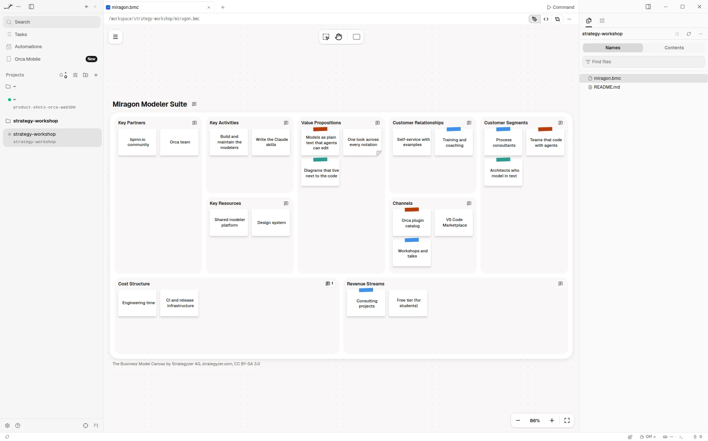
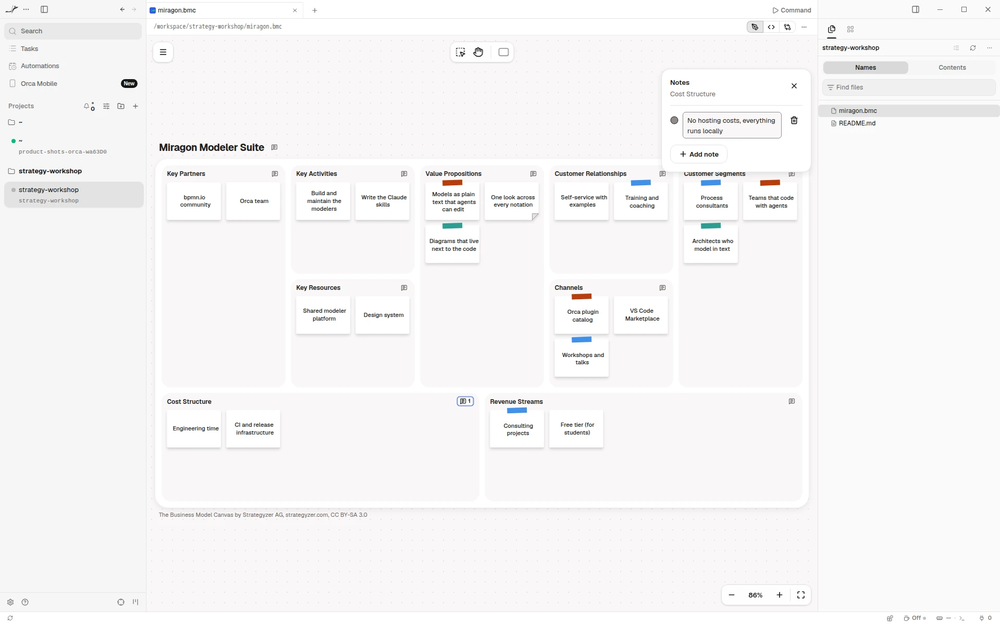
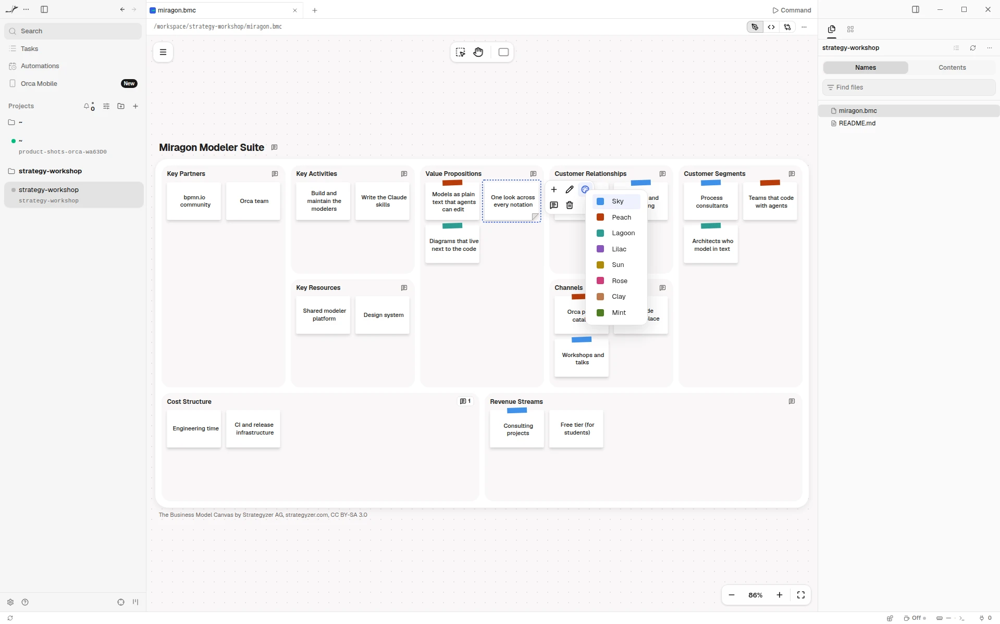

# Business Model Canvas for Orca

See the business models your agent writes, and edit them right next to it. In
[Orca](https://www.onorca.dev), a `.bmc` file opens as a Business Model Canvas instead of text: the
nine building blocks of a business model, with stickies in tape colours that mean what your team
makes them mean, and notes for what you still have to test. The file stays plain text (YAML), so
your agent reads and writes it like code.

Free and open source (MIT). No account, no network access, and it sees only the file you open.

**[Open in Orca](https://www.onorca.dev/plugins/miragon/orca-modelers/business-model-canvas-modeler)**

## Get started

1. Turn on plugins in Orca once: Settings → Plugins → **Turn on plugins**.
2. Open the plugin's page with the link above, or search for **Miragon** in Settings → Plugins,
   and install it. New releases reach you through Orca.
3. Click **Try it** to open an example canvas, or open any `.bmc` file. **+** in the tab bar starts
   a new one from the example too.
4. New to the canvas? It describes how an organisation creates, delivers and captures value, in
   nine blocks of short notes, from the customer segments to the cost structure.

## Live while your agent writes

Each change your agent makes to the file shows up on the canvas right away. If it writes while you
have unsaved edits, the editor merges its changes with yours when they touch different stickies,
notes or the title. When you both changed the same sticky, block or the title, or one side
removed what the other changed, Orca asks whether to reload the file or keep yours.

## Notes on what you still have to test

Write notes on a sticky, a block or the whole canvas in the **Notes** panel, such as an
assumption still to test: "Assumption: hotels order every day". Open it from
**Notes** in the context pad or the menu, from the comment at the end of a block heading or after
the canvas title, or with N. A folded corner shows that a sticky has notes; hover it to read them.

## Colour stickies

Select a sticky and pick one of eight colours from **Colour** in its context pad: it shows as tape
across the sticky's top edge, on white paper. A common way to use them is one colour per customer
segment, on the segment and on every sticky that serves it.

## Export for slides

Export a canvas as PNG or SVG from the menu. Orca's save dialog asks where to put the file. Every
picture carries the canvas's attribution, and the `.bmc` file stays the source you edit.

## Good to know

- Needs the Orca desktop app, version 1.4.252 or later.
- Orca shows no problems list for the editor. While the text is not a valid canvas, the canvas
  shows the last valid version.
- The canvas writes the file anew when you edit it, so comments in the text do not stay. Remarks
  belong in the notes of a sticky, a block or the whole canvas.
- The canvas stays light in Orca's dark theme.
- **Keyboard shortcuts…** in the canvas's menu lists every key and gesture.
- The Business Model Canvas is by Strategyzer AG, [strategyzer.com](https://www.strategyzer.com),
  licensed under [CC BY-SA 3.0](https://creativecommons.org/licenses/by-sa/3.0/). This plugin is
  not affiliated with or endorsed by Strategyzer AG.
- Also available for [VS Code](../vscode/README.md).

## Links

[Changelog](CHANGELOG.md) · [Report an issue](https://github.com/Miragon/modeler-suite/issues) ·
[Source and contributing](../../../../CONTRIBUTING.md#orca-plugins) ·
[All Miragon modelers for Orca](https://github.com/Miragon/orca-modelers)

Made by [Miragon](https://www.miragon.io). MIT licence.
