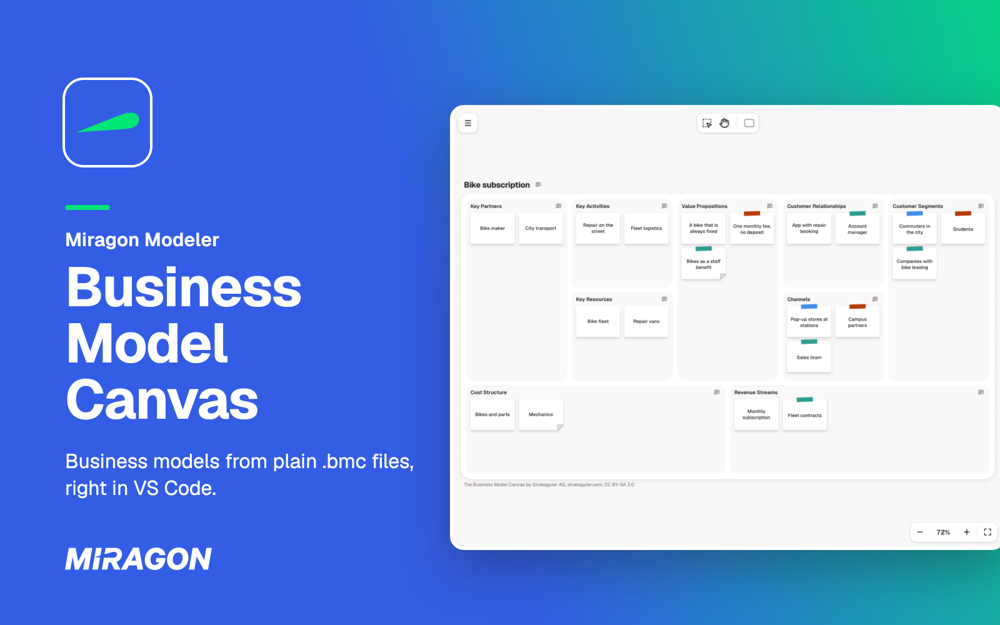
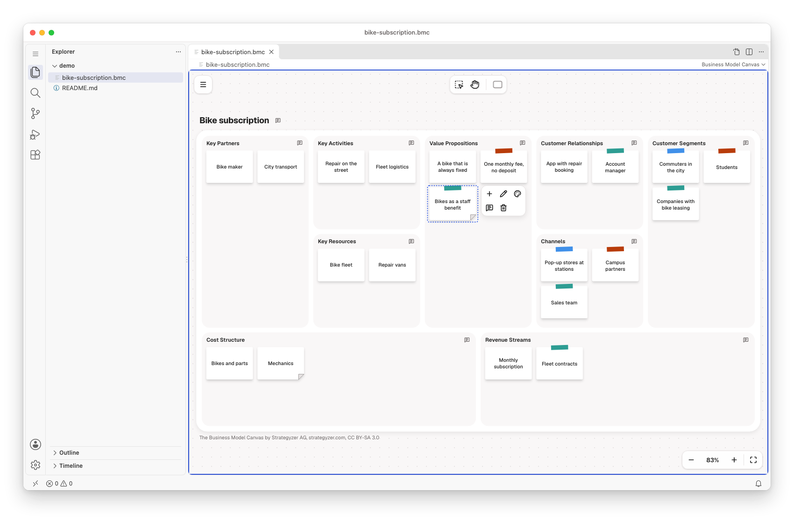
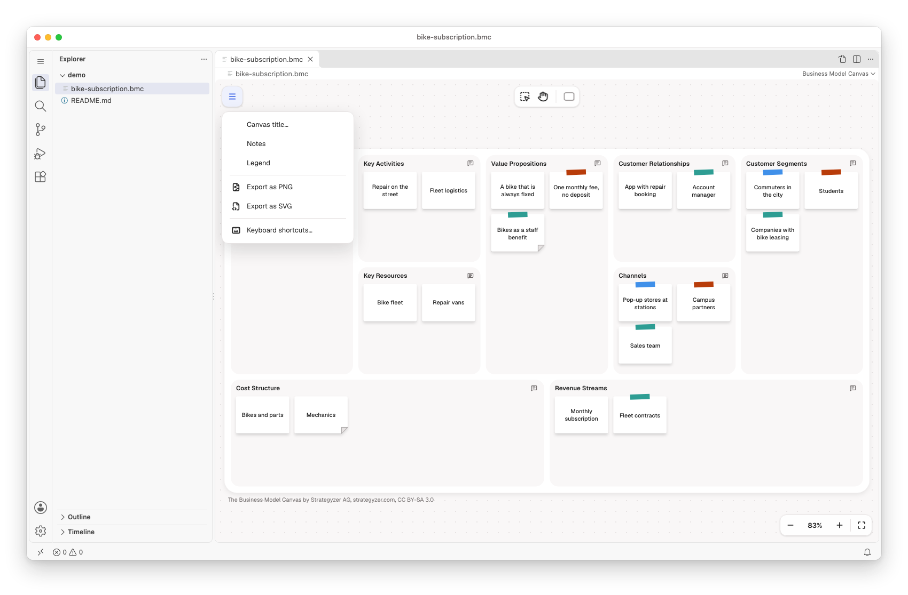
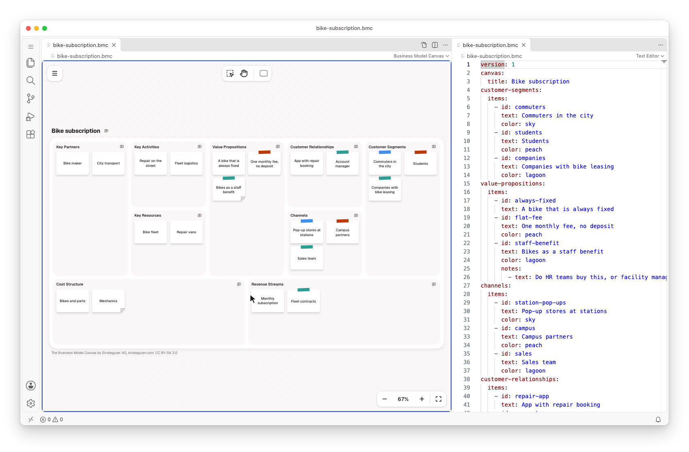
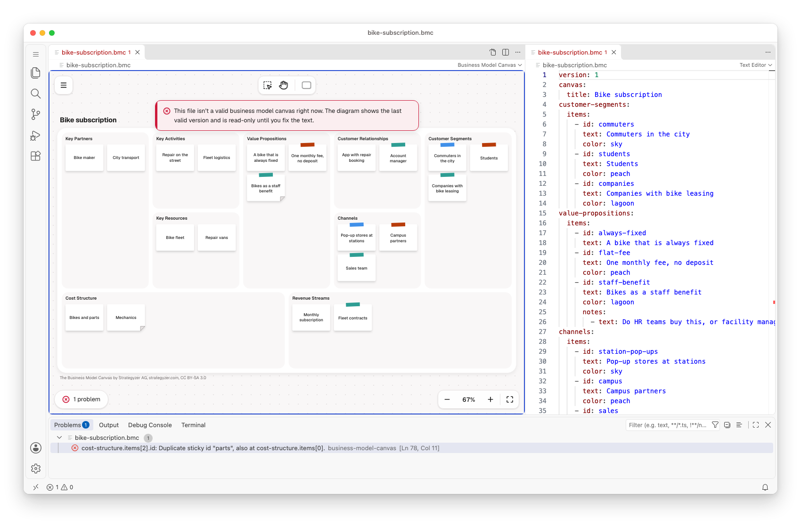

# Business Model Canvas for VS Code

[](https://marketplace.visualstudio.com/items?itemName=miragon-gmbh.business-model-canvas-modeler)
[](https://github.com/Miragon/modeler-suite/blob/main/modelers/business-model-canvas/LICENSE)



Fill in a Business Model Canvas in VS Code: the nine building blocks of a business model on one
page, from the customer segments you serve to the costs it takes. Each canvas is a plain-text
`.bmc` file, so it stays in your own repository, next to the plans it explains.

Free and open source (MIT). No account, no telemetry, and it works offline.

## Get started

1. Run **Business Model Canvas: New Business Model Canvas from Example** or **New Empty Business
   Model Canvas** from the Command Palette (`Ctrl/Cmd+Shift+P`), or open any `.bmc` file.
2. New to the canvas? It describes how an organisation creates, delivers and captures value, in
   nine blocks of short notes. The walkthrough **Get Started with the Business Model Canvas** shows
   you how to read and fill one.

## Fill the blocks



Add a sticky from the palette or from the context pad of another one, and drag it to another block
or place. Stickies flow in the order of the file, and a block that fills up grows its whole row.
Give a sticky one of eight colours from **Colour** in its context pad: it shows as tape across the
sticky's top edge. What a colour means is your team's to decide, such as the customer segment a
sticky serves. A folded corner shows that a sticky has notes, as the legend says. Click the title
to edit it. Undo and save work as for any other file.

## Notes on stickies, blocks and the whole canvas

Write notes in the **Notes** panel: a remark, a question, an assumption to test. Open it from the
comment after the canvas title or at the end of a block heading, from **Notes** in a sticky's
context pad or the menu, or with N. A comment shows how many notes its place has, and hovering it
or a sticky shows them.

## Export for slides



Export a canvas as PNG or SVG from the menu. Every picture carries the canvas's attribution. The
`.bmc` file stays the source you edit.

## Text and canvas side by side



**Business Model Canvas: Open Source to the Side** shows the canvas's text next to the canvas. Type
in the text and the canvas follows. Move or edit a sticky and its entry in the text changes, while
fields the canvas does not know stay. The text is YAML. Comments do not stay, since the canvas
writes the file anew: put a remark into a note instead.

## Mistakes show up as problems



The **Problems** view points at what is wrong in the file. While the text is not a valid canvas,
the canvas shows the last valid version read-only. Unknown fields at the root or in a block, an
unknown colour, and comments the canvas would drop show as warnings.

## Canvases written by an AI agent

A canvas is a text file, so a coding agent can write it, and the canvas redraws when the file
changes. For Claude Code, the `business-model-canvas-modeler` plugin teaches the method and the
`.bmc` format, so you can ask Claude to draft a canvas from your notes or to review one:

```text
/plugin marketplace add Miragon/modeler-suite
/plugin install business-model-canvas-modeler@modeler-suite
```

## Good to know

- Needs VS Code 1.96 or later on the desktop. VS Code for the Web is not supported.
- There is no live co-editing. Share canvases through Git, or open them in the
  [web app](https://business-model-canvas.modeler.miragon.io), which makes share links.
- **Keyboard shortcuts…** in the canvas's menu lists every key and gesture.
- The canvas stays light in dark themes.
- The Business Model Canvas is by Strategyzer AG, [strategyzer.com](https://www.strategyzer.com),
  licensed under [CC BY-SA 3.0](https://creativecommons.org/licenses/by-sa/3.0/). The hints in
  empty blocks are Miragon's own. This extension is not affiliated with or endorsed by Strategyzer
  AG.

## Links

[Changelog](https://github.com/Miragon/modeler-suite/blob/main/modelers/business-model-canvas/apps/vscode/CHANGELOG.md)
·
[Report an issue](https://github.com/Miragon/modeler-suite/issues)
·
[Source and contributing](https://github.com/Miragon/modeler-suite/blob/main/modelers/business-model-canvas/CONTRIBUTING.md)
·
[Third-party licences](https://github.com/Miragon/modeler-suite/blob/main/modelers/business-model-canvas/apps/vscode/THIRD_PARTY_NOTICES.md)

Made by [Miragon](https://www.miragon.io). MIT licence.
