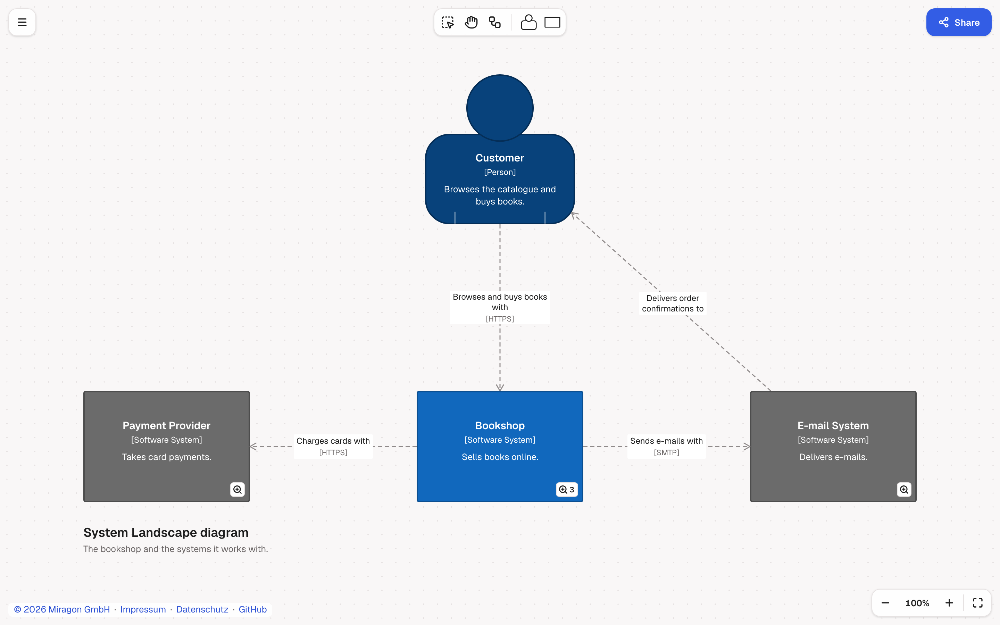

# C4 Modeler

Draw how your software is built, from the big picture down to its parts, using the
[C4 model](https://c4model.com): who uses which systems, which containers (apps, services,
databases) make up a system and which components make up a container. You draw on a canvas; the
modeler keeps everything in one plain-text Structurizr DSL file (`.c4` or `.dsl`), so the diagram
lives in Git next to your code and reviews like any other change. Available as a **web app** and a
**VS Code extension**, part of the [Miragon modeler suite](../../README.md).

Compatible with Structurizr DSL. Structurizr is a product of Structurizr Limited; this project is
not affiliated with or endorsed by Structurizr Limited.

**[Try the web app →](https://c4.modeler.miragon.io)**

## Why use it

- **One model, many views.** Draw the system landscape, a system context, container and component
  views. Click the badge on a system or container to open the next level down; the breadcrumb at
  the top left takes you back up.
- **Your file stays yours.** Edits change only the lines they touch. Comments, formatting and
  everything the modeler does not draw (deployment, dynamic views, docs, ADRs) stay exactly as
  written, and Structurizr still opens the file.
- **Layout is saved in the file.** Positions you set are stored with each view, so moving a box is
  a one-line diff. Views you have not arranged are laid out automatically.
- **Safe editing.** Every change is one undo step, and deleting asks first when it would remove an
  element from more than this view.
- **Classic C4 colours** for new workspaces; Model › Apply C4 colours adds them to an existing one.

## Try it

- **In the browser:** open [c4.modeler.miragon.io](https://c4.modeler.miragon.io), start from the
  example or drop in a `.c4` / `.dsl` file. Export as PNG, SVG, `.c4` or `workspace.dsl`. Share
  copies a link that holds the whole workspace; it is never sent to a server.
- **In VS Code:** install
  [C4 Modeler](https://marketplace.visualstudio.com/items?itemName=miragon-gmbh.c4-modeler) and
  run **C4: New C4 Diagram from Example**. See the [extension's README](apps/vscode/README.md).

An example workspace is in [`example/bookshop.c4`](example/bookshop.c4). How positions are stored
in the file is described in
[the layout format](packages/schema-model/README.md#the-layout-format).

## Keyboard shortcuts

On the focused canvas, next to the shell's zoom and fit keys:

| Key                                  | Action                                                               |
| ------------------------------------ | -------------------------------------------------------------------- |
| L, H, C                              | lasso, hand, connect tool                                            |
| E, double-click                      | edit the name or description (Tab moves on)                          |
| Enter, U, G                          | open the selected element's view, parent view, Views…                |
| Delete, Backspace                    | remove from this view, or from the model when no other view shows it |
| Shift+Delete                         | Delete from model…                                                   |
| Arrows, Shift+Arrows                 | move the selection                                                   |
| Esc                                  | clear the selection                                                  |
| Cmd/Ctrl+Arrows, Space (held)        | move the canvas, hand                                                |
| Cmd/Ctrl+A                           | select every element of the view                                     |
| Cmd/Ctrl+Z, Cmd/Ctrl+Shift+Z, Ctrl+Y | undo, redo (in VS Code, the editor's own)                            |
| ?, Cmd/Ctrl+O, Cmd/Ctrl+S            | shortcuts, open a file, export `.c4` (web app)                       |

Tab reaches the context pad of the selection: Arrows, Home and End move, Enter or Space runs an
entry, Esc returns to the canvas.

## Learn more

- [CONTRIBUTING.md](CONTRIBUTING.md): build, run and test the modeler, architecture and packages.
- [Packages](packages/): schema model, DSL reader and editor, layout and renderer, each on npm.
- Issues go to [Miragon/modeler-suite](https://github.com/Miragon/modeler-suite/issues).

## Licence

MIT. The C4 model is Simon Brown's; this is an independent tool that implements it.
