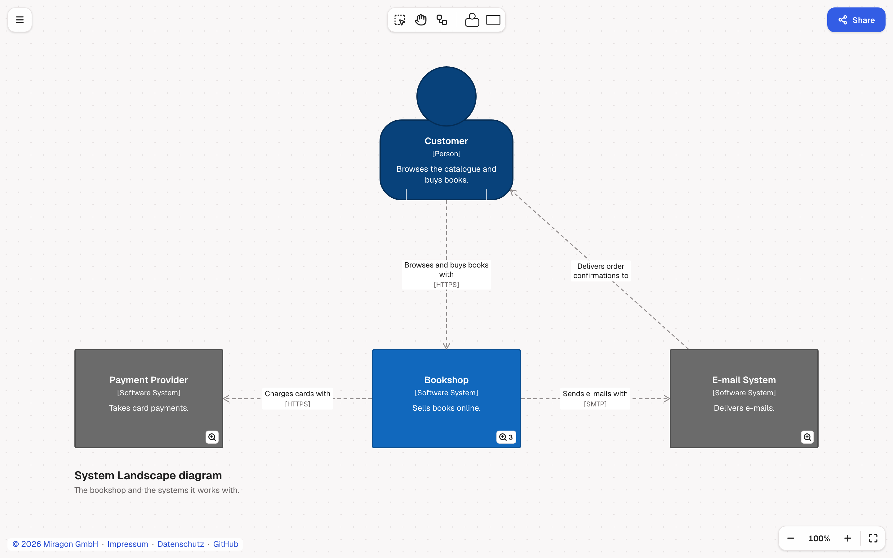

# C4 Modeler

[](LICENSE)
[](https://github.com/Miragon/modeler-suite/actions/workflows/ci.yml)

Draw the [C4 model](https://c4model.com) of your software on a canvas, backed by a plain-text
Structurizr DSL workspace. One model, many views: a system landscape, a system context per software
system, a container view per system and a component view per container, and you move between them
by drilling down. The file (`.c4`, the modeler's own, or any `.dsl`) stays the source of truth, and
the layout of every view goes into the same file. Ships as a **web app** and a **VS Code
extension** on one diagram-js renderer, as `modelers/c4` of the
[Miragon modeler suite](../../README.md).

Compatible with Structurizr DSL. Structurizr is a product of Structurizr Limited; this project is
not affiliated with or endorsed by Structurizr Limited.



## What it does

- It opens a Structurizr workspace as it is. The modeler reads the DSL losslessly and writes back
  only the lines an edit touches: comments, formatting, constants, includes, scripts, deployment
  environments, `!docs` and `!adrs` stay byte for byte. Whatever the modeler saves, the Structurizr
  CLI, Structurizr local and the Structurizr server still open.
- It edits four kinds of views on the canvas: system landscape, system context, container and
  component views. Add people, software systems, containers (also as a database) and components
  from the palette and connect them; edit names, descriptions and technologies on the canvas, and
  tags, URLs and identifiers in the inspector. Dynamic, deployment, filtered, custom and image
  views are listed and kept for Structurizr.
- It navigates the way the C4 model reads. The badge on a software system or container (or Enter)
  opens the view one level deeper. Below the system landscape, the breadcrumb at the top left
  shows the path from the landscape down to the view you are in, and a click on any view in it
  opens that view; U goes up one level. Model › Views… (G) lists every view of the workspace. A
  view that is not in the file yet opens as a draft, marked "Not in the file yet" in the
  breadcrumb, and is written with your first edit in it; looking around never changes the file.
- It keeps the layout in your file. Your first move in a view writes the position of every
  element into that view's `properties`, one line per element, so a later move is a one-line diff
  and travels with the model through Git. An element added later gets its line as it arrives (one
  added in the text, with the next change in the view), so nothing jumps. A view without positions
  is laid out automatically.
- It deletes with care. Delete removes an element from this view, or from the model when no other
  view shows it, and both apps say which it was; Delete from model (Shift+Delete) asks first
  when the deletion reaches further. Every change is one undo step.

## The file

The model and the views are plain Structurizr DSL. The positions the canvas sets are view
properties with the `c4modeler.` prefix, in modeler units (15/8 Structurizr pixels), which
Structurizr ignores:

```text
container bookshop "Containers-bookshop" "The parts the bookshop is built from." {
    include *
    autoLayout tb 300 160
    properties {
        "c4modeler.element.api" "560,640"
        "c4modeler.element.customer" "572,0"
        "c4modeler.element.webApp" "560,360"
    }
}
```

`"c4modeler.element.<identifier>"` holds `"x,y"` (with `,w,h` for a resized element),
`"c4modeler.relationship.<key>"` the bends of a line. Elements without an identifier get one the
first time the modeler needs to refer to them. New views are written with `include *` and
`autoLayout tb 300 160`, so Structurizr lays them out on its own. New workspaces start with the
classic C4 palette, tuned for contrast, as tag styles; Model › Apply C4 colours writes it into a
workspace that lacks it. Without styles a workspace is drawn monochrome, like Structurizr's
default. The example in [`example/bookshop.c4`](example/bookshop.c4), an online bookshop, shows
all of it.

## Targets

- **Web app** ([`apps/webapp`](apps/webapp)): the editor in the browser, in the shared Miragon
  modeler chrome ([`@miragon/modeler-shell`](https://www.npmjs.com/package/@miragon/modeler-shell),
  web host): palette, context pad, inspector, legend, problems list, a start screen, a drop zone
  for `.c4`, `.dsl` and `.txt` files, export as PNG, SVG, `.c4` (the native file, Structurizr DSL
  inside) and `workspace.dsl`, and a URL that holds the whole workspace and the view it shows
  after every change, so a reload, a bookmark or Share keeps it. The workspace stays in the URL's
  hash (`#mz=`, compressed), which never reaches a server; a pasted link replaces the workspace,
  and the one it replaced stays an Undo away.
- **VS Code extension** ([`apps/vscode`](apps/vscode/README.md), `miragon-gmbh.c4-modeler`): a
  custom editor that opens `.c4` files, and `.dsl` files with Open Diagram to the Side or Reopen
  Editor With…, since `.dsl` files belong to other tools too (C4: Use C4 Modeler for workspace.dsl
  makes it the editor of every `workspace.dsl`). Next to LikeC4, which uses `.c4` as well, a
  LikeC4 model opens as text. The file stays the source of truth, so saving, Git, diff and undo
  work as for any text file. It adds the Structurizr DSL language with syntax colouring, the
  parser's findings in the Problems view, and C4: Go to View….

The renderer implements the collaborative-modeler contract of
[`@miragon/modeler-api`](https://www.npmjs.com/package/@miragon/modeler-api) and runs its
conformance kit, so collaborative hosts embed it without knowing the notation.

| Package                                             | Purpose                                                                                                              | DOM |
| --------------------------------------------------- | -------------------------------------------------------------------------------------------------------------------- | --- |
| [`@miragon/c4-schema-model`](packages/schema-model) | the C4 model of a workspace as plain data: elements, relationships, views, styles, identifiers, view membership      | no  |
| [`@miragon/c4-dsl`](packages/dsl)                   | read and edit Structurizr DSL losslessly: syntax tree, model and diagnostics, edits that change only what they touch | no  |
| [`@miragon/c4-layout`](packages/layout)             | lay out views automatically and place new elements next to their neighbours                                          | no  |
| [`@miragon/c4-renderer`](packages/renderer)         | viewer and modeler on diagram-js, implementing `@miragon/modeler-api`                                                | yes |

## Keyboard shortcuts

On the focused canvas, next to the shell's zoom and fit keys:

| Key                                  | Action                                                               |
| ------------------------------------ | -------------------------------------------------------------------- |
| L, H, C                              | lasso, hand, connect tool                                            |
| E                                    | edit the name, or a relationship's description (Tab moves on)        |
| Double-click                         | edit the text under the pointer                                      |
| Enter                                | open the view of the selected software system or container           |
| U                                    | parent view                                                          |
| G                                    | Views…                                                               |
| Delete, Backspace                    | remove from this view, or from the model when no other view shows it |
| Shift+Delete                         | Delete from model…                                                   |
| Arrows, Shift+Arrows                 | move the selection                                                   |
| Esc                                  | clear the selection                                                  |
| Cmd/Ctrl+Arrows                      | move the canvas                                                      |
| Space (held)                         | hand                                                                 |
| Cmd/Ctrl+A                           | select every element of the view                                     |
| Cmd/Ctrl+Z, Cmd/Ctrl+Shift+Z, Ctrl+Y | undo, redo (in VS Code, the editor's own undo and redo)              |
| ?                                    | keyboard shortcuts (web app)                                         |
| Cmd/Ctrl+O, Cmd/Ctrl+S               | open a file, export the `.c4` file (web app)                         |

In the context pad of the selection, which Tab reaches from the canvas:

| Key               | Action                                        |
| ----------------- | --------------------------------------------- |
| Arrows, Home, End | move to the previous, next, first, last entry |
| Enter, Space      | run the entry                                 |
| Esc               | back to the canvas, the selection kept        |

## Getting started

Requires Node `^22.22.2` or `>=24.15.0` and npm; the Portless dev server needs Node 24.15 or later.
From the root of the suite:

```sh
npm ci && npm run build:shared # once: every workspace, the shared packages
npm run c4 dev:webapp:plain    # the web app on plain Vite, http://127.0.0.1:5182
npm run c4 dev:webapp          # the web app through Portless, at https://<branch>.c4.localhost
npm run c4 build               # the packages (the unit tests resolve them from dist)
npm run c4 test                # unit tests
npm run c4 test:browser        # the renderer in Chromium, with the modeler-api conformance kit
npm run c4 test:e2e            # Playwright: web app and VS Code webview, with the shell conformance kit
npm run c4 test:vscode:docker  # the extension in a real VS Code, in Docker (no window on the host)
npm run c4 lint                # ESLint and every tsconfig
```

## Architecture

```text
packages/
  schema-model/  @miragon/c4-schema-model  DOM-free: the semantic model, identifiers, views, styles, the layout codec
  dsl/           @miragon/c4-dsl           DOM-free: lexer, lossless syntax tree, builder, diagnostics, the edit layer
  layout/        @miragon/c4-layout        DOM-free: auto-layout with @dagrejs/dagre, placement, frames
  renderer/      @miragon/c4-renderer      diagram-js: store, edits as commands, in-place sync, drawing, interaction
apps/
  webapp/        @miragon/c4-webapp        the web app on the modeler shell
  vscode/        c4-modeler                the VS Code extension
e2e/                                       Playwright: the web app and the VS Code webview
```

The canvas holds no model of its own: every gesture becomes an edit of the DSL text, which the
`dsl` package computes, applies and verifies (the result parses, nothing else changed) before the
canvas command runs, and refuses with a reason when it can't. The three DOM-free packages run in
any JavaScript runtime; ESLint and dependency-cruiser keep diagram-js and the DOM out of them.
The design and its rules for contributors are in [`CLAUDE.md`](CLAUDE.md).

## Contributing

See [CONTRIBUTING.md](CONTRIBUTING.md) and the agent notes in [CLAUDE.md](CLAUDE.md) for this
modeler, the suite's [CONTRIBUTING.md](../../CONTRIBUTING.md) for setup, scripts, hooks and
conventions, and [docs/ci-and-releases.md](../../docs/ci-and-releases.md) for CI and releases.
Issues go to [Miragon/modeler-suite](https://github.com/Miragon/modeler-suite/issues).

## Licence

MIT. The C4 model is Simon Brown's; this is an independent tool that implements it. Structurizr is
a product of Structurizr Limited; this project is not affiliated with or endorsed by Structurizr
Limited.
