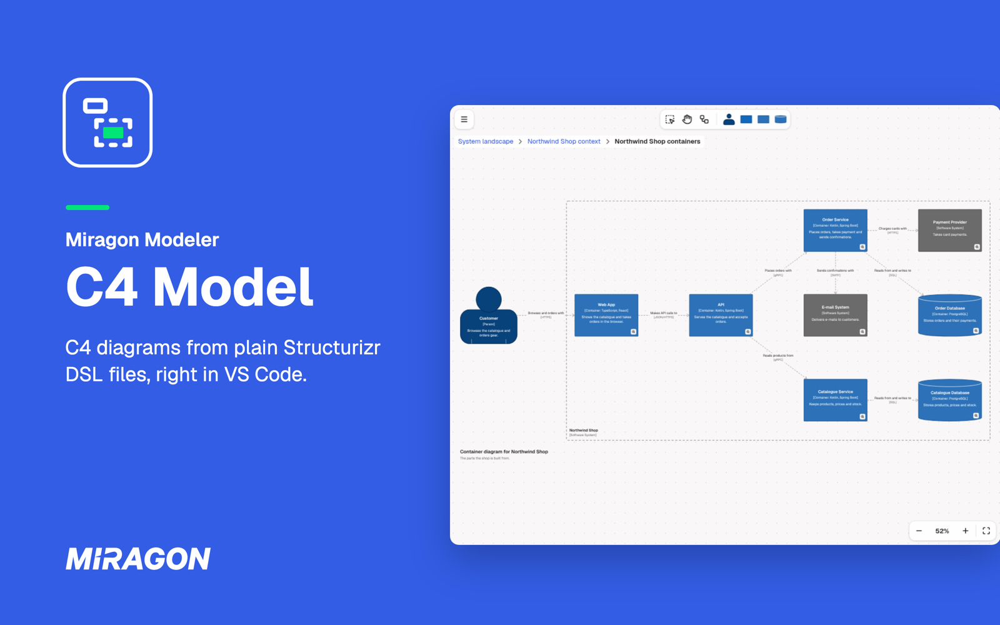
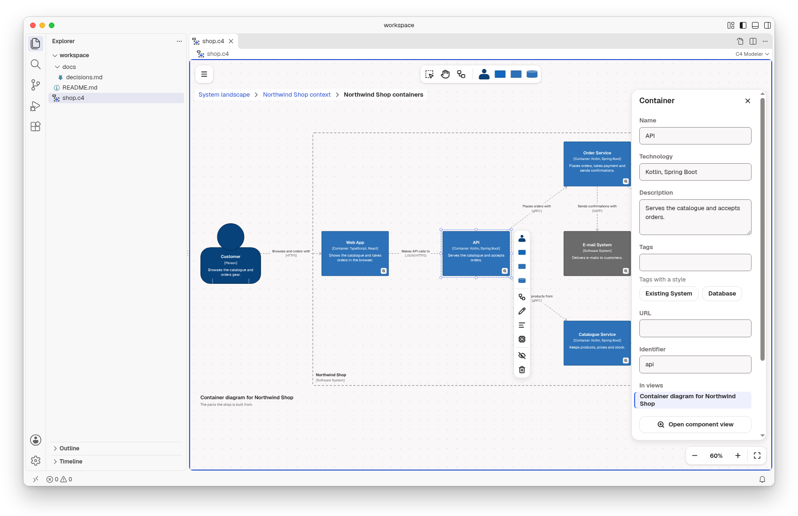
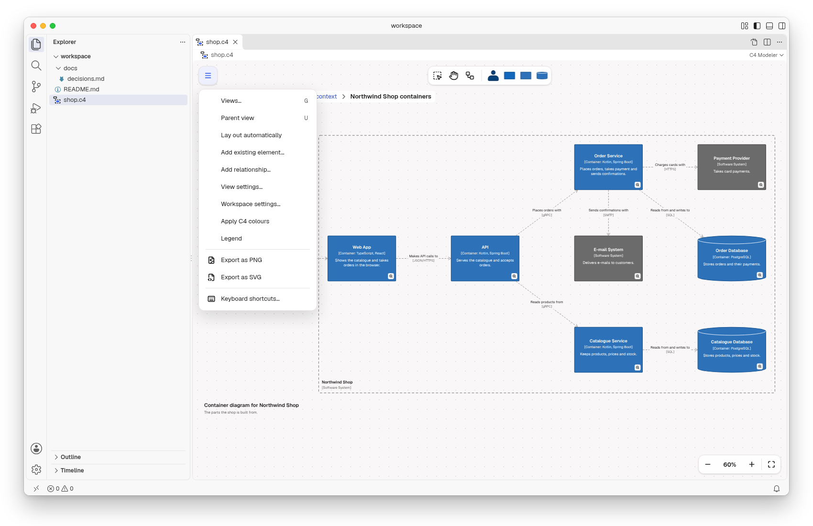
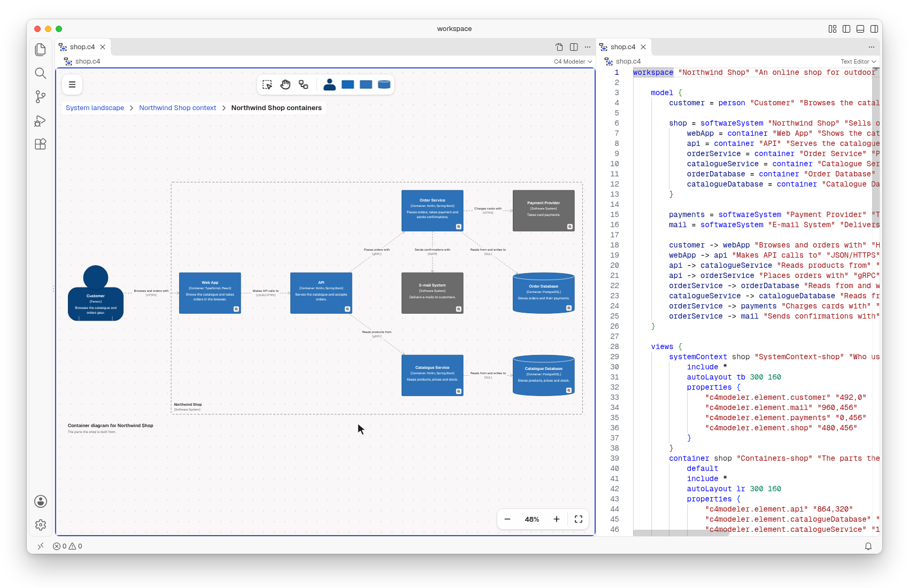
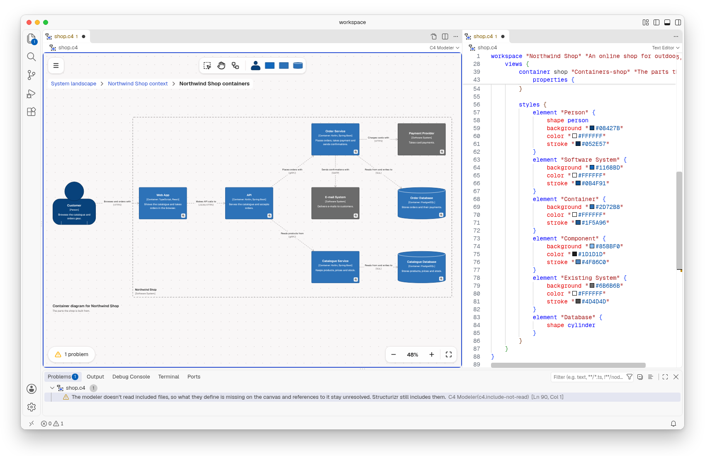

# C4 Model for VS Code

Draw how your software is built with the [C4 model](https://c4model.com) in VS Code: the system
landscape, a system context per software system, a container view per system and a component view
per container. Everything is one plain-text Structurizr DSL file (`.c4` or `.dsl`), layout included,
so it stays in your own repository, next to your code, and still opens in Structurizr.

Free and open source (MIT). No account, no telemetry, and it works offline.

## Get started

1. Run **C4: New C4 Diagram from Example** from the Command Palette (`Ctrl/Cmd+Shift+P`), or open
   any `.c4` file.
2. New to the C4 model? It describes a software system at four levels of zoom, from the people and
   systems around it down to its parts. The walkthrough **Get Started with the C4 Modeler** shows
   you how to read and edit a workspace.

## Draw on the canvas

Place people, software systems, containers, databases and components from the palette. Select an
element to append or connect another one, edit its name, description or technology, remove it from
the view or delete it from the model. Undo and save work as for any other file.

## Move between views

The badge on a system or container (or Enter) opens the view one level deeper, the breadcrumb opens
any view above, and U goes up. **C4: Go to View…** lists every view of the workspace, grouped by
type, and **C4: Parent View** goes one level up. The canvas edits system landscape, system context,
container and component views. Dynamic, deployment, filtered, custom and image views, deployment
environments, `!docs`, `!adrs` and scripts stay exactly as written.

## Export for slides

Export a view as PNG or SVG from the menu. **Apply C4 colours** writes the classic C4 colours as
tag styles into your workspace; new workspaces start with them. The `.c4` file stays the source you
edit.

## Text and diagram side by side

**C4: Open Source to the Side** shows the workspace's DSL next to the diagram. Type in the DSL and
the diagram follows. Edit the diagram and the DSL changes, but only the lines you touched: your
comments, blank lines and order stay as you wrote them. Positions are stored in the view's
`properties`, which Structurizr ignores.

## Mistakes show up as problems

The **Problems** view lists the parser's findings for every open workspace. Most findings leave the
diagram editable. When the text can't be read at all, such as an unbalanced block, the diagram
shows the last valid version read-only, and the text stays as you wrote it.

## Opening `.dsl` files

`.dsl` files belong to more than one tool, so VS Code opens them as text. Open one in the C4 Modeler
with **Open Diagram to the Side** in the editor title, or **Reopen Editor With… › C4 Modeler**.
**C4: Use C4 Modeler for workspace.dsl** makes it the editor of every `workspace.dsl` (it writes
`workbench.editorAssociations` in your user settings). Structurizr local reads `workspace.dsl` by
default, so give a workspace that name when Structurizr local shows it too.

### With LikeC4 installed

[LikeC4](https://likec4.dev) uses `.c4` too. A Structurizr workspace starts with `workspace` (or a
directive such as `!const`), a LikeC4 model never does: with LikeC4 installed, a `.c4` file that is
no Structurizr workspace opens as text in LikeC4's language, a blank one in the C4 Modeler. To open
every `.c4` as text, add `"*.c4": "default"` to `workbench.editorAssociations`. To stop LikeC4
reporting problems in a Structurizr workspace, exclude it with `likec4.exclude` (for example
`"**/workspace.c4"`) or `exclude` in `likec4.config.json`.

## Workspaces written by an AI agent

A workspace is a text file, so a coding agent can write it, and the diagram redraws when the file
changes.

## Good to know

- Needs VS Code 1.96 or later on the desktop. VS Code for the Web is not supported.
- There is no live co-editing. Share workspaces through Git, or open them in the
  [web app](https://c4.modeler.miragon.io), which makes share links.
- **Keyboard shortcuts…** in the menu lists every key and gesture.
- Compatible with Structurizr DSL. Structurizr is a product of Structurizr Limited; this project is
  not affiliated with or endorsed by Structurizr Limited.

## Links

[Changelog](https://github.com/Miragon/modeler-suite/blob/main/modelers/c4/apps/vscode/CHANGELOG.md)
·
[Report an issue](https://github.com/Miragon/modeler-suite/issues)
·
[Source and contributing](https://github.com/Miragon/modeler-suite/blob/main/modelers/c4/CONTRIBUTING.md)
·
[Third-party licences](https://github.com/Miragon/modeler-suite/blob/main/modelers/c4/apps/vscode/THIRD_PARTY_NOTICES.md)

Made by [Miragon](https://www.miragon.io). MIT licence.
