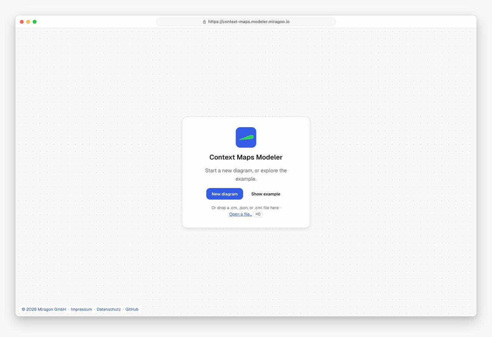

# Context Maps Modeler

[](LICENSE)
[](https://marketplace.visualstudio.com/items?itemName=miragon-gmbh.context-maps-modeler)
[](https://www.npmjs.com/package/@miragon/context-maps-renderer)

Draw **context maps**, the strategic view of Domain-Driven Design: which parts of a business
(bounded contexts) exist, how important each one is, and how the teams behind them work together.
Use it to agree on boundaries, spot risky dependencies and explain your landscape to business and
IT alike. Each map is a plain `.cm` or `.cm.json` file, so it lives in your repository next to
your code.

Free and open source (MIT). No account, and it works offline. Part of the
[Miragon modeler suite](../../README.md).

**[Try the web app →](https://context-maps.modeler.miragon.io)**



## Use it where you work

- **In the browser:** the [web app](https://context-maps.modeler.miragon.io) needs no install and
  keeps your map in the browser. Start from the example, a blank map or a dropped `.cm`, `.json` or
  Context Mapper `.cml` file. **Share** copies a link that holds the whole map; nothing is
  uploaded. Export PNG, SVG, JSON or CML.
- **In VS Code:** the [Context Maps Modeler](apps/vscode/README.md) opens `.cm` and `.cm.json`
  files as maps, with the JSON side by side, the rule checks in the Problems view and editable
  pictures (`*.cm.png`) for wikis and READMEs.
- **In Orca:** the [Orca plugin](apps/orca/README.md) shows each change your coding agent writes
  to the map as it happens.

Press `?` in any of them for every key and gesture.

## What you can draw

**Bounded contexts** are boxes, coloured by how much they matter to the business:

| Type                 | Icon          | Meaning                                   |
| -------------------- | ------------- | ----------------------------------------- |
| Core Domain          | star          | Business-critical and differentiating.    |
| Supporting Subdomain | open hand     | Specialised, but not differentiating.     |
| Generic Subdomain    | dotted circle | Solved / off-the-shelf: buy, don't build. |

**Relationships** are lines that say how two contexts cooperate. A thicker line means more
coordination between the teams.

| Pattern             | Abbr. | Line                    | Direction    |
| ------------------- | ----- | ----------------------- | ------------ |
| Partnership         | P     | indigo, thick solid     | both ways    |
| Shared Kernel       | SK    | green, thick long-dash  | both ways    |
| Customer-Supplier   | C/S   | orange, dash-dot        | one way, U/D |
| Upstream-Downstream | U/D   | grey, thin solid        | one way, U/D |
| Separate Ways       | SW    | light grey, fine dotted | none         |

On one-way relationships the upstream side can offer an **Open Host Service (OHS)** and/or a
**Published Language (PL)**; the downstream side protects itself with an **Anticorruption Layer
(ACL)** or follows as a **Conformist (CF)**. The modeler checks thirteen rules of strategic DDD, most
adopted from [Context Mapper](https://contextmapper.org/), and shows what breaks them.

## The file

A `.cm.json` file is small, readable JSON: a list of contexts and the relationships between them.

```jsonc
{
  "version": 1,
  "title": "Conference event planner: context map",
  "contexts": [
    {
      "id": "ctx_cfp",
      "label": "CfP Management",
      "subdomainType": "core",
      "position": { "x": 340, "y": 120 },
      "size": { "width": 200, "height": 110 },
    },
  ],
  "relationships": [
    {
      "id": "rel_cfp_submission",
      "from": "ctx_cfp",
      "to": "ctx_submission",
      "pattern": "upstream-downstream",
      "upstreamRoles": ["OHS"],
      "downstreamRoles": ["ACL"],
    },
  ],
}
```

## Build on it

Embed maps in your own app with the npm packages
[`@miragon/context-maps-renderer`](packages/renderer/README.md) (viewer and modeler),
[`@miragon/context-maps-schema-model`](packages/schema-model/README.md) (the file format) and
[`@miragon/context-maps-cml`](packages/cml) (Context Mapper CML in and out):

```bash
npm install @miragon/context-maps-renderer
```

Building, running and testing the modeler is in [CONTRIBUTING.md](CONTRIBUTING.md). Issues go to
[Miragon/modeler-suite](https://github.com/Miragon/modeler-suite/issues).

## Licence

[MIT](LICENSE). The bundled Lucide icons of the modeler shell and the renderer are ISC (partly
Feather, MIT); the star and open hand of the core and supporting subdomains are Material Icons
`star` and `pan_tool`, Apache-2.0 (© Google LLC). The web app's bundle keeps their licence
comments.
