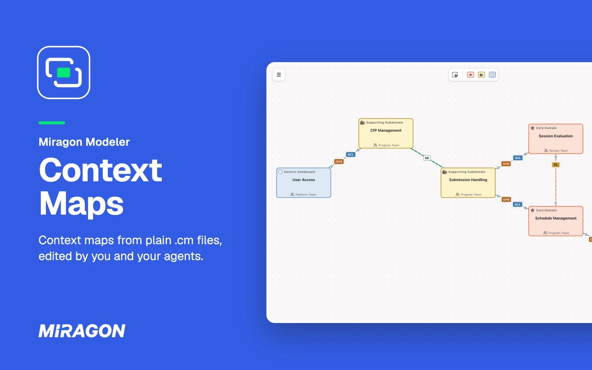
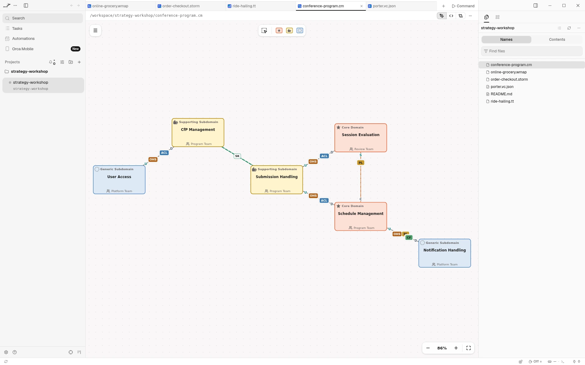
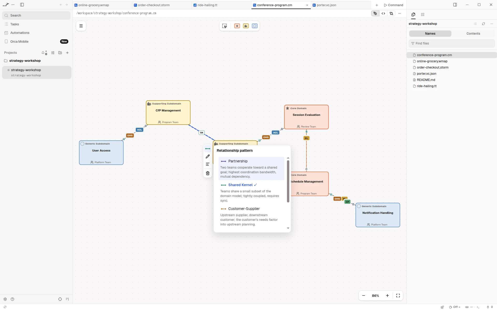
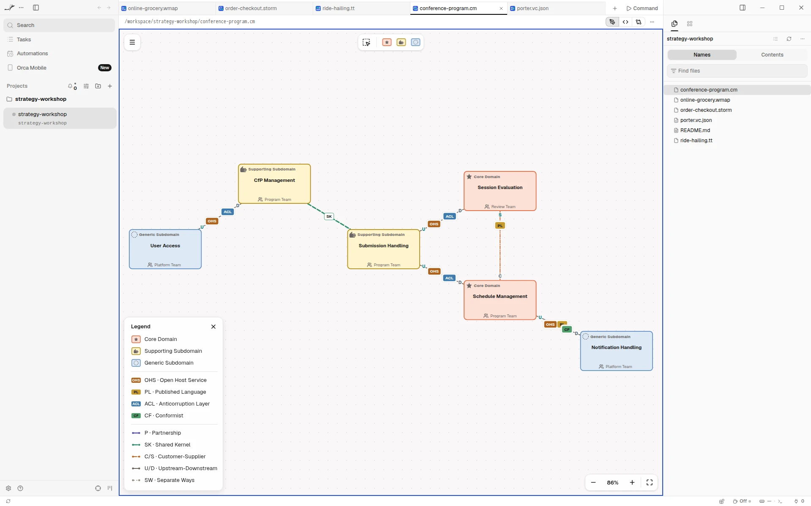

# Context Maps for Orca

See the context maps your agent writes, and edit them right next to it. In
[Orca](https://www.onorca.dev), a `.cm` or `.cm.json` file opens as a map of the strategic view of
Domain-Driven Design instead of text: the bounded contexts of a business, how important each one
is, and how their teams work together. The file stays plain JSON, so your agent reads and writes
it like code.

Free and open source (MIT). No account, no network access, and it sees only the file you open.

**[Open in Orca](https://www.onorca.dev/plugins/miragon/orca-modelers/context-maps-modeler)**

## Get started

1. Turn on plugins in Orca once: Settings → Plugins → **Turn on plugins**.
2. Open the plugin's page with the link above, or search for **Miragon** in Settings → Plugins,
   and install it. New releases reach you through Orca.
3. Open any `.cm` or `.cm.json` file.
4. New to context maps? A context map shows which bounded contexts a business has and how they
   integrate, from partnership to separate ways.

## Live while your agent writes

Each change your agent makes to the file shows up on the canvas right away. If it writes while you
have unsaved edits, Orca asks whether to reload the file or keep yours.

## Draw on the canvas

Drag a subdomain type from the palette onto the canvas. Select a context to append a connected one,
connect it, change its subdomain type, set its owning team or description, rename or delete it.
Select a relationship to pick its pattern and integration roles, or swap its ends. Undo and save
work as you expect.

## Read the map

- **Bounded contexts** are coloured by subdomain type: core (star) is business-critical and
  differentiating; supporting (open hand) is specialised but not differentiating; generic (dotted
  circle) is a solved problem you buy rather than build.
- **Relationships** are styled per pattern: partnership (P) and shared kernel (SK) are symmetric;
  customer-supplier (C/S) and upstream-downstream (U/D) have an upstream and a downstream end;
  separate ways (SW) means no integration.
- **Integration roles** sit at the ends: upstream offers an Open Host Service (OHS) or a Published
  Language (PL); downstream protects itself with an Anticorruption Layer (ACL) or conforms (CF).
- **Legend** in the menu explains every colour and line.

## Export for slides and Context Mapper

Export a map as PNG or SVG from the menu, or as JSON or [Context Mapper](https://contextmapper.org/)
CML. Orca's save dialog asks where to put the file. The `.cm` file stays the source you edit.

## Good to know

- Needs the Orca desktop app, version 1.4.248 or later.
- Orca shows no problems list for the editor. The check against 13 rules of strategic DDD, the
  CML import and editable pictures (`*.cm.png`) are in [VS Code](../vscode/README.md) and the web
  app.
- The map stays light in Orca's dark theme.
- **Keyboard shortcuts…** in the map's menu lists every key and gesture.
- Also available for [VS Code](../vscode/README.md) and as a
  [web app](https://context-maps.modeler.miragon.io) that makes share links.

## Links

[Changelog](CHANGELOG.md) · [Report an issue](https://github.com/Miragon/modeler-suite/issues) ·
[Source and contributing](../../../../CONTRIBUTING.md#orca-plugins) ·
[All Miragon modelers for Orca](https://github.com/Miragon/orca-modelers)

Made by [Miragon](https://www.miragon.io). MIT licence.
