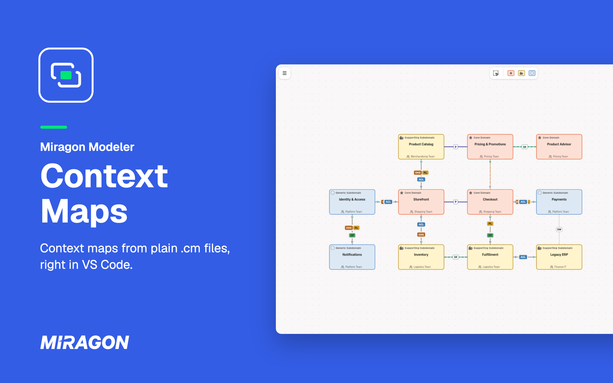
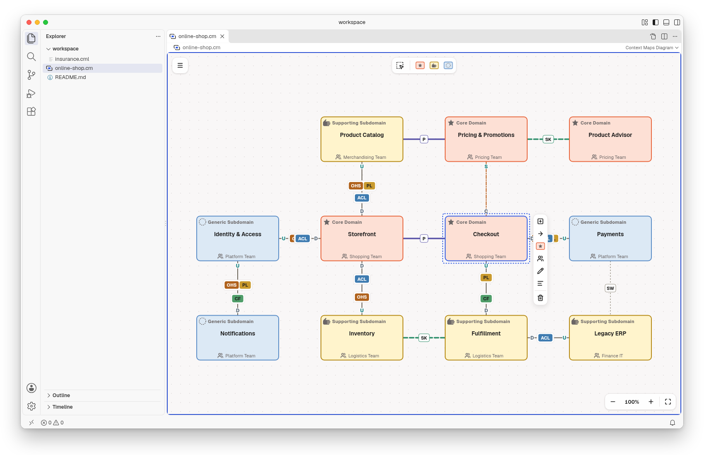
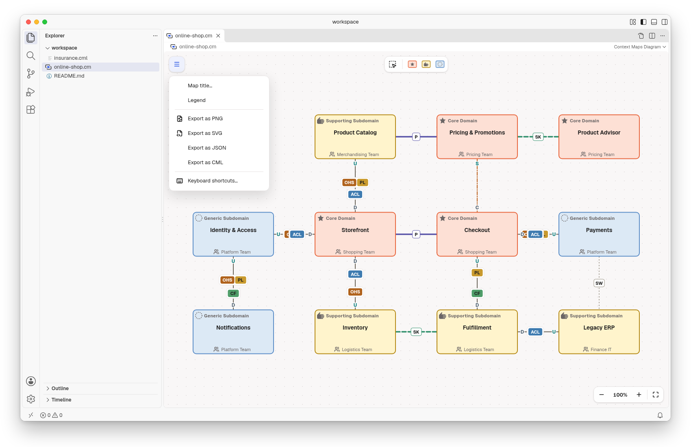
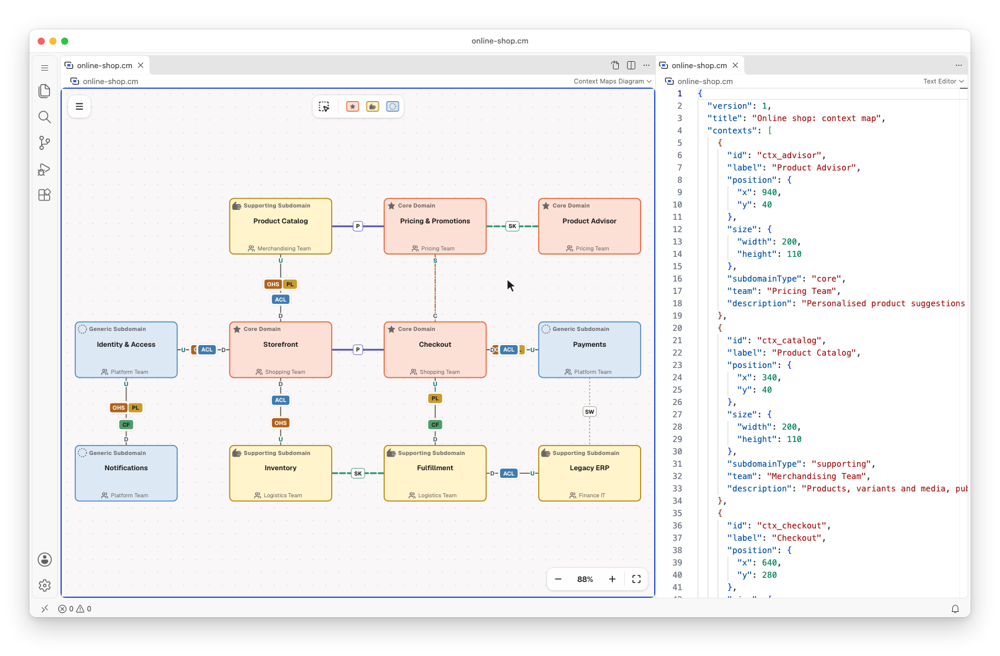
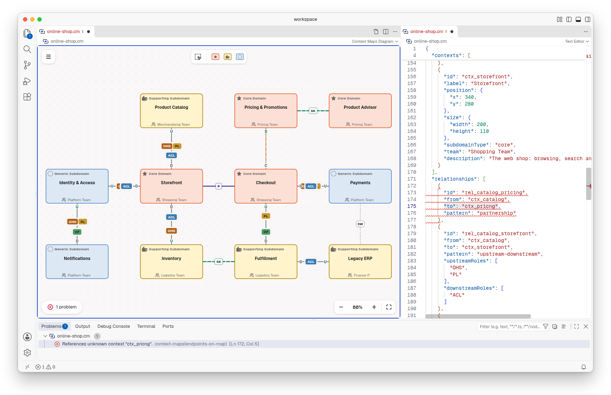

# Context Maps for VS Code

Draw the strategic view of Domain-Driven Design in VS Code: the bounded contexts of a business, how
important each one is, and how their teams work together. Each map is a plain `.cm` or `.cm.json`
file (deterministic JSON), so it stays in your own repository, next to your code. Maps from [Context
Mapper](https://contextmapper.org/) come in and go out as CML.

Free and open source (MIT). No account, no telemetry, and it works offline.

## Get started

1. Run **Context Maps: New Diagram from Example** from the Command Palette (`Ctrl/Cmd+Shift+P`), or
   open any `.cm` or `.cm.json` file.
2. New to context maps? A context map shows which bounded contexts a business has and how they
   integrate, from partnership to separate ways. The walkthrough **Get Started with Context Maps
   Modeler** shows you how to read and edit one.

## Draw on the canvas

Drag a subdomain type from the palette onto the canvas. Select a context to append a connected one,
connect it, change its subdomain type, set its owning team or description, rename or delete it.
Select a relationship to pick its pattern and integration roles, or swap its ends. Undo and save
work as for any other file.

## Read the map

- **Bounded contexts** are coloured by subdomain type: core (star, warm red) is business-critical
  and differentiating; supporting (open hand, amber) is specialised but not differentiating;
  generic (dotted circle, blue) is a solved problem you buy rather than build.
- **Relationships** are styled per pattern: partnership (P, thick indigo) and shared kernel (SK,
  thick green dashes) are symmetric; customer-supplier (C/S, orange dash-dot) and
  upstream-downstream (U/D, thin grey) have an upstream and a downstream end; separate ways (SW,
  fine dotted grey) means no integration.
- **Integration roles** sit at the ends: upstream offers an Open Host Service (OHS) or a Published
  Language (PL); downstream protects itself with an Anticorruption Layer (ACL) or conforms (CF).
- **Legend** in the menu explains every colour and line.

## Export for slides

Export a map as PNG or SVG from the menu, or as JSON or Context Mapper CML. The `.cm` file stays
the source you edit.

## Text and diagram side by side

**Context Maps: Open Source to the Side** shows the map's JSON next to the diagram. Type in the JSON
and the diagram follows. Edit the diagram and the JSON changes.

## Mistakes show up as problems

The **Problems** view lists what is wrong in the file, and checks the map against 13 rules of
strategic DDD, such as "protect the core with an ACL". While the JSON can't be read, the diagram
shows the last valid version read-only, and the text stays as you wrote it.

## Context Mapper

**Context Maps: New Diagram from CML…** turns the context map of a Context Mapper `.cml` file into
a `.cm` file. It reads the contexts and relationships with their patterns and roles; the rest of
the CML file is left out, and a warning counts what was skipped. **Export as CML** writes your map
back as CML.

## Diagrams as editable images

A `*.cm.png` file is a picture that carries its map, so you can drop it into a wiki or a README and
still open it here to edit. Start one with **Context Maps: New Empty Diagram (embedded PNG)** and
save once.

## Maps written by an AI agent

A map is a JSON file, so a coding agent can write it, and the diagram redraws when the file
changes.

## Good to know

- Needs VS Code 1.96 or later on the desktop. VS Code for the Web is not supported.
- There is no live co-editing. Share maps through Git, or open them in the
  [web app](https://context-maps.modeler.miragon.io), which makes share links.
- **Keyboard shortcuts…** in the map's menu lists every key and gesture.
- The diagram stays light in dark themes.

## Links

[Changelog](https://github.com/Miragon/modeler-suite/blob/main/modelers/context-maps/apps/vscode/CHANGELOG.md)
·
[Report an issue](https://github.com/Miragon/modeler-suite/issues)
·
[Source and contributing](https://github.com/Miragon/modeler-suite/blob/main/modelers/context-maps/CONTRIBUTING.md)
·
[Third-party licences](https://github.com/Miragon/modeler-suite/blob/main/modelers/context-maps/apps/vscode/THIRD_PARTY_NOTICES.md)

Made by [Miragon](https://www.miragon.io). MIT licence.
