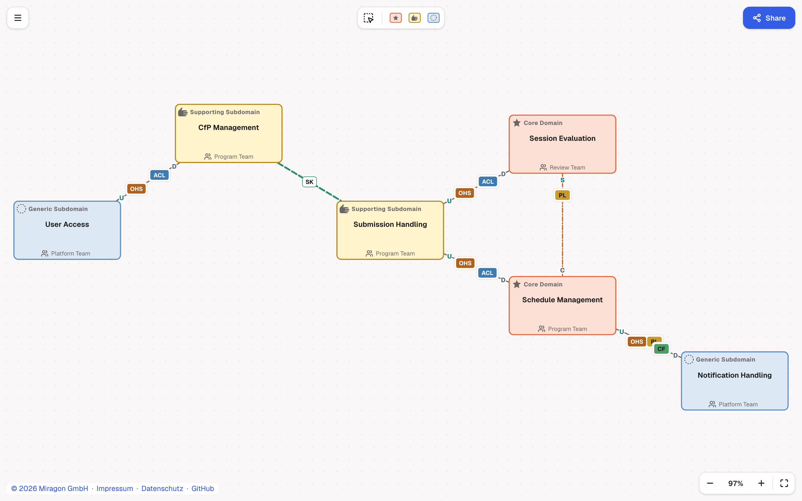

# Context Maps Modeler: Web App

Draw strategic Domain-Driven Design [Context Maps](https://contextmapper.org/) in your browser. No
sign-up and no server: your map stays on your machine, and you share it as a link.

**[Open the web app](https://context-maps.modeler.miragon.io)**

## What you can do

- **Start** from the example, a blank map, or a file you drop in (`.cm`, `.json` or Context Mapper
  `.cml`). Replacing a map offers **Undo**.
- **Model** contexts and relationships with the palette, and see rule violations on the canvas and
  in the problems list.
- **Share** a map as a link: it is compressed into the URL, nothing is uploaded.
- **Export** PNG, SVG, JSON (`Cmd/Ctrl+S`) or CML.
- **Pick up where you left off**: the map is saved in your browser automatically. A shared link
  opens before the saved map.
- **Work offline**: no external calls, fonts included.

## Run it locally

Development setup, commands and deployment are in the modeler's
[CONTRIBUTING.md](../../CONTRIBUTING.md).

## License

[MIT](../../LICENSE). The bundled Lucide icons of the modeler shell and the renderer are ISC (partly
Feather, MIT); the renderer's star and open hand of the core and supporting subdomains are Material
Icons `star` and `pan_tool`, Apache-2.0 (© Google LLC). The bundle keeps their licence comments.
