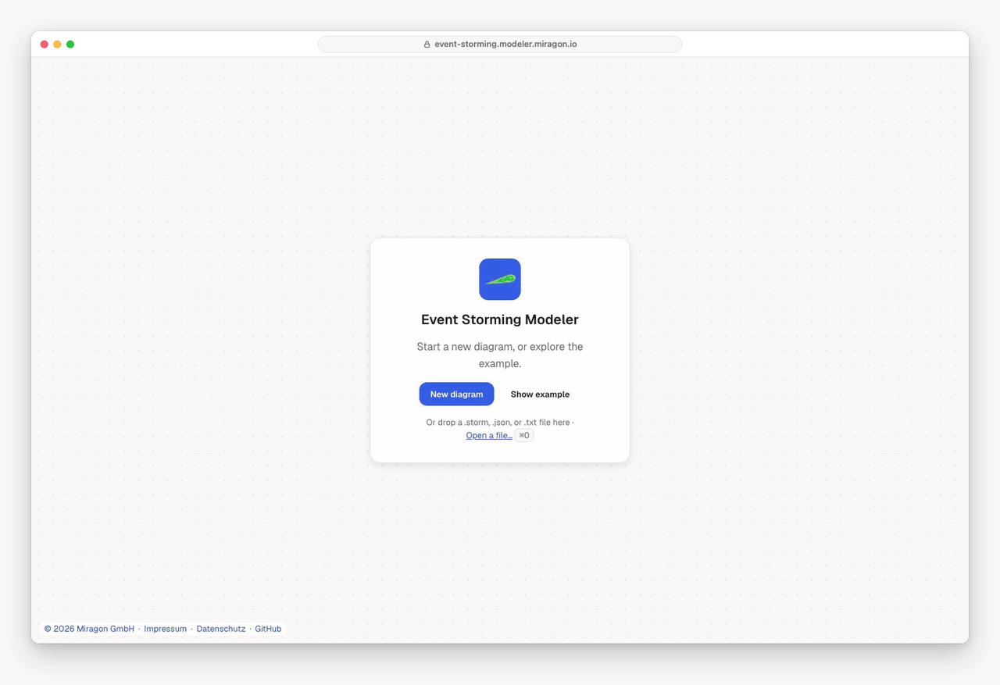

# Event Storming Modeler

[](LICENSE)
[](https://marketplace.visualstudio.com/items?itemName=miragon-gmbh.event-storming-modeler)
[](https://www.npmjs.com/package/@miragon/event-storming-renderer)

Run [Event Storming](https://www.eventstorming.com/) on a digital board: domain events on a
timeline, the commands that trigger them, and the people, policies and systems around them. Each
board is a plain-text `.storm` file, so it lives in your repository, shows up as a readable diff
and evolves with the code it describes.

Free and open source (MIT). No account, and it works offline. Part of the
[Miragon modeler suite](../../README.md).

**[Try the web app →](https://event-storming.modeler.miragon.io)**



## Use it where you work

- **In the browser:** the [web app](https://event-storming.modeler.miragon.io) needs no install.
  Open or drop a `.storm`, `.json` or `.txt` file. **Share** copies a link that holds the whole
  board. Export PNG, SVG, a transparent PNG at four times the size, JSON or `.storm`.
- **In VS Code:** the [Event Storming Modeler](apps/vscode/README.md) opens `.storm` files as
  boards, with the text side by side and problems in the Problems view.
- **In Orca:** the [Orca plugin](apps/orca/README.md) shows each change your coding agent writes
  to the board as it happens.
- **With Claude Code:** the
  [`event-storming-modeler` plugin](plugins/event-storming-modeler/README.md) teaches Claude the
  method and the `.storm` format, so it can draft a board from your notes or review one with
  feedback notes on the board.

Press `?` in any of them for every key and gesture.

## What you can draw

| Sticky              | Colour       | Stands for                                |
| ------------------- | ------------ | ----------------------------------------- |
| **Domain Event**    | orange       | something that happened in the domain     |
| **Command**         | blue         | an intent that triggers an event          |
| **Actor**           | light yellow | the person who issues a command           |
| **Aggregate**       | yellow       | what takes the command and decides        |
| **Policy**          | purple       | "whenever this event, then that command"  |
| **Read Model**      | green        | the information someone needs to decide   |
| **External System** | pink         | a system outside the domain               |
| **Hotspot**         | red          | a question, a risk or a conflict to solve |

Plus notes, freeform drawings and labelled arrows between stickies. **Level** in the menu switches
between big picture, process modeling and software design, and offers the stickies of that
workshop format. **Aggregates…** lists every aggregate with the commands that lead into it and the
events that follow.

## The `.storm` file

One line per sticky, `<kind> <Name> [x, y]`, and one per arrow, `A -> B`. Lines the board can't
use stay in the file as written. The example
[`example/order-checkout.storm`](example/order-checkout.storm) begins like this:

```text
title Order Checkout

actor Customer [80, 300]
command Place Order [240, 300]
aggregate Order [420, 290] (id agg_order)
event Order Placed [620, 300]
hotspot Double payment on retry? [620, 520]

Customer -> Place Order
Place Order -> #agg_order
#agg_order -> Order Placed
```

The full grammar is in [`@miragon/event-storming-dsl`](packages/dsl).

## Build on it

Embed boards in your own app with the npm packages:

```bash
npm install @miragon/event-storming-renderer
```

```ts
import { NavigatedViewer } from "@miragon/event-storming-renderer";
import "@miragon/event-storming-renderer/assets/event-storming.css";

const viewer = new NavigatedViewer({ container: document.querySelector("#canvas")! });
await viewer.importDSL(`title Order Checkout
command Place Order [240, 300]
event Order Placed [620, 300]
Place Order -> Order Placed`);
const { svg } = await viewer.saveSVG();
```

| Package                                                         | What it is                                                           |
| --------------------------------------------------------------- | -------------------------------------------------------------------- |
| [`@miragon/event-storming-renderer`](packages/renderer)         | diagram-js viewer and modeler, import and export                     |
| [`@miragon/event-storming-dsl`](packages/dsl)                   | `.storm` text ↔ model, lossless round-trip (DOM-free)                |
| [`@miragon/event-storming-schema-model`](packages/schema-model) | Board metamodel, Zod validation, deterministic JSON (DOM-free)       |
| [`@miragon/event-storming-transforms`](packages/transforms)     | Pure `EventStormingBoard → EventStormingBoard` transforms (DOM-free) |

Building, running and testing the modeler is in [CONTRIBUTING.md](CONTRIBUTING.md). Issues go to
[Miragon/modeler-suite](https://github.com/Miragon/modeler-suite/issues).

## Licence

[MIT](LICENSE). Based on the [Wardley Maps Modeler](../wardley-maps/README.md).
