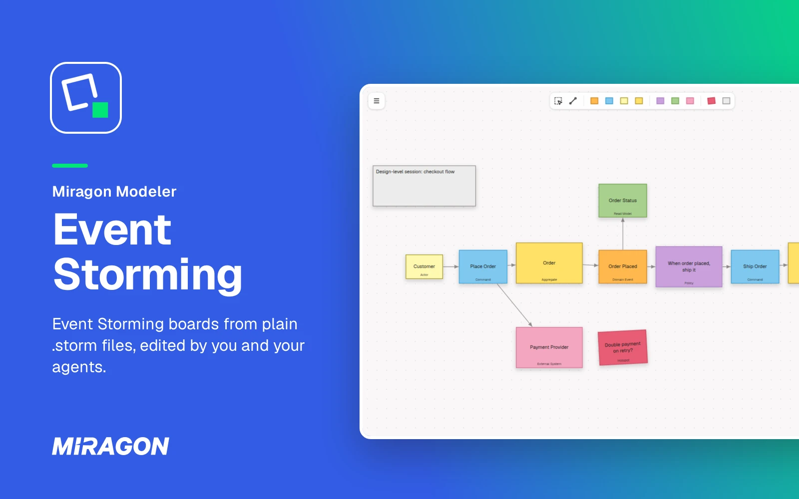
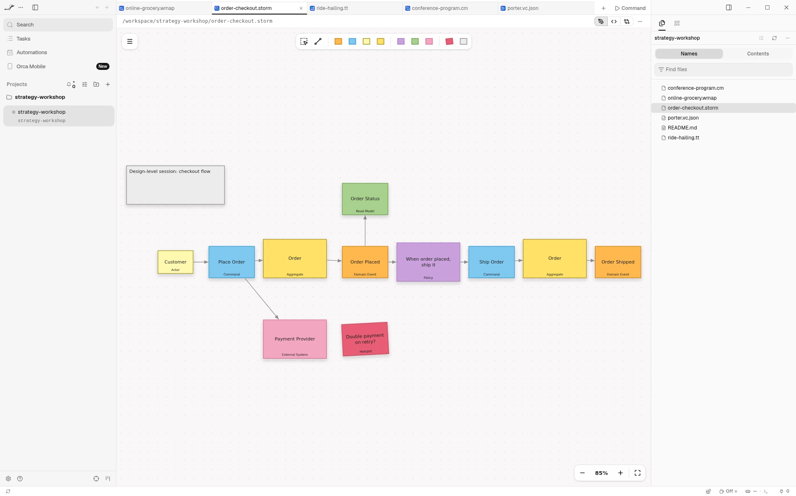
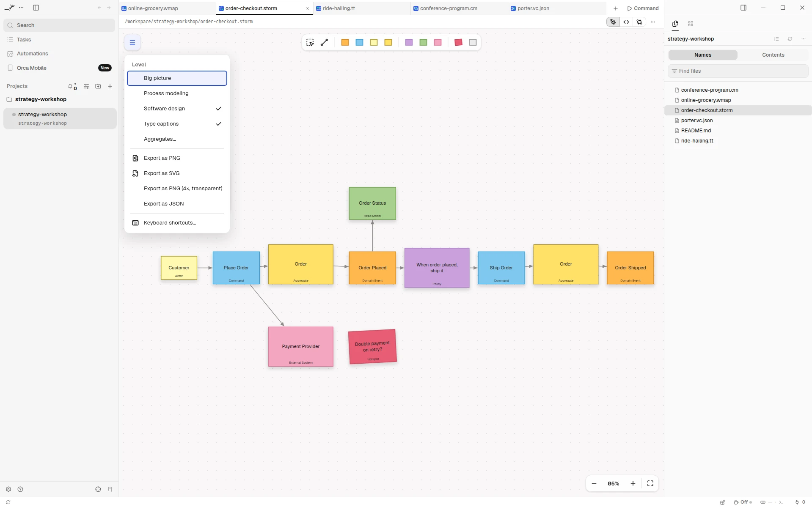
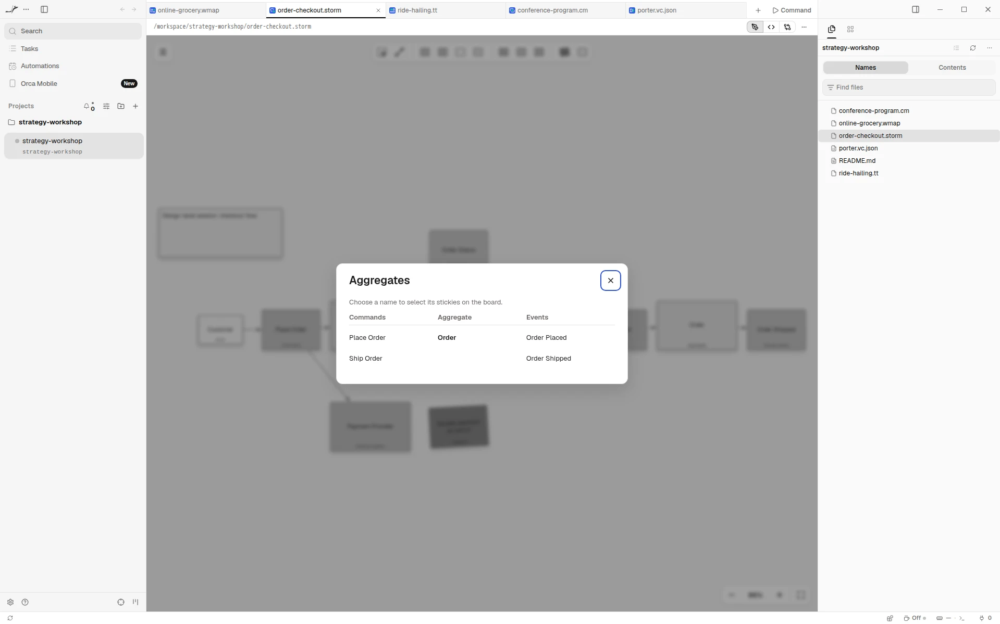

# Event Storming for Orca

[](https://github.com/Miragon/modeler-suite/blob/main/modelers/event-storming/LICENSE)



See the [Event Storming](https://www.eventstorming.com) boards your agent writes, and edit them
right next to it. In [Orca](https://www.onorca.dev), a `.storm` file opens as a board of sticky
notes instead of text: domain events on a timeline, the commands that trigger them, and the
people, policies and systems around them. The file stays plain text, so your agent reads and
writes it like code.

Free and open source (MIT). No account, no network access, and it sees only the file you open.

**[Open in Orca](https://www.onorca.dev/plugins/miragon/orca-modelers/event-storming-modeler)**

## Get started

1. Turn on plugins in Orca once: Settings → Plugins → **Turn on plugins**.
2. Open the plugin's page with the link above, or search for **Miragon** in Settings → Plugins,
   and install it. New releases reach you through Orca.
3. Open any `.storm` file.
4. New to Event Storming? It is a workshop format for exploring a business domain with sticky
   notes. Alberto Brandolini's book
   [Introducing EventStorming](https://leanpub.com/introducing_eventstorming) explains the method.

## Live while your agent writes



Each change your agent makes to the file shows up on the board right away. If it writes while you
have unsaved edits, the editor merges its changes with yours when they touch different stickies,
notes, drawings or arrows. Only when you both changed the same element does Orca ask whether to
reload the file or keep yours.

## Draw on the board

Place stickies from the palette: **Domain Event** orange, **Command** blue, **Actor** light yellow,
**Aggregate** yellow, **Policy** purple, **Read Model** green, **External System** pink and
**Hotspot** red, plus notes and drawings. Select a sticky to append, connect, change its type or
delete it. Time flows left to right, and arrows connect the stickies into a story. Undo and save
work as you expect.

## Workshop levels



**Level** in the menu switches between big picture, process modeling and software design. Each
level offers the stickies of that workshop format.

## Aggregates at a glance



**Aggregates…** lists every aggregate with the commands that lead into it and the events that
follow, and selects its stickies on the board.

## Export for slides

Export a board as PNG or SVG from the menu, as a transparent PNG at four times the size for slides,
or as JSON. Orca's save dialog asks where to put the file. The `.storm` file stays the source you
edit.

## Let your agent write the boards

For Claude Code, the `event-storming-modeler` plugin teaches your agent the method and the `.storm`
format, so you can ask it to draft a board from your notes or to review one:

```text
/plugin marketplace add Miragon/modeler-suite
/plugin install event-storming-modeler@modeler-suite
```

## Good to know

- Needs the Orca desktop app, version 1.4.252 or later.
- Orca shows no problems list for the editor. Lines it can't use stay in the file as written, and
  the board keeps drawing everything else.
- The board stays light in Orca's dark theme.
- **Keyboard shortcuts…** in the board's menu lists every key and gesture.
- Also available for [VS Code](../vscode/README.md) and as a
  [web app](https://event-storming.modeler.miragon.io) that makes share links.

## Links

[Changelog](CHANGELOG.md) · [Report an issue](https://github.com/Miragon/modeler-suite/issues) ·
[Source and contributing](../../../../CONTRIBUTING.md#orca-plugins) ·
[All Miragon modelers for Orca](https://github.com/Miragon/orca-modelers)

Made by [Miragon](https://www.miragon.io). MIT licence.
