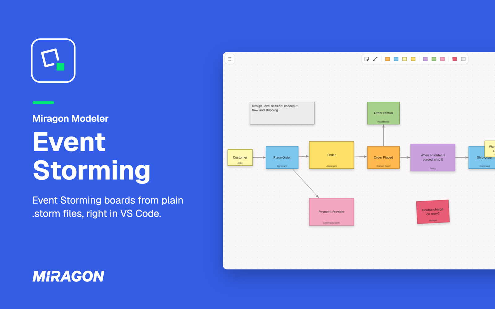
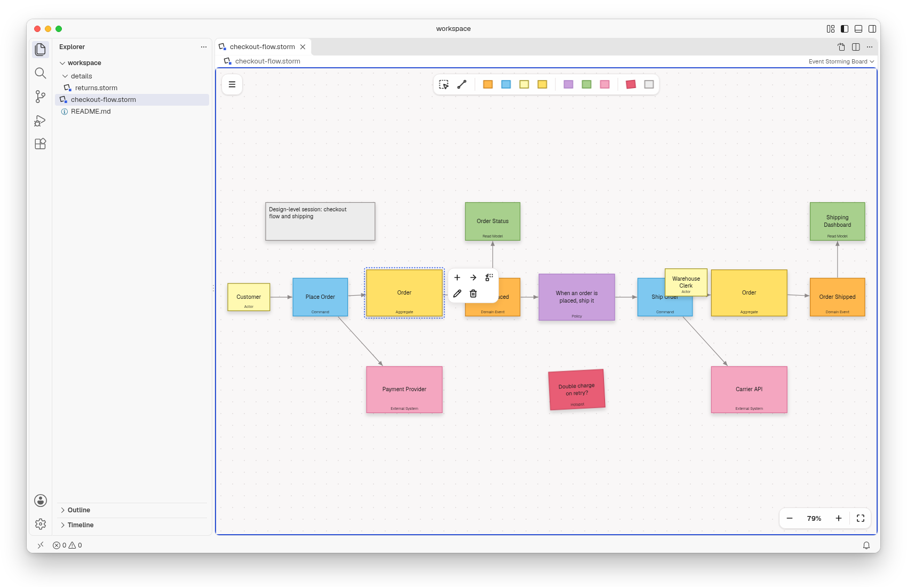
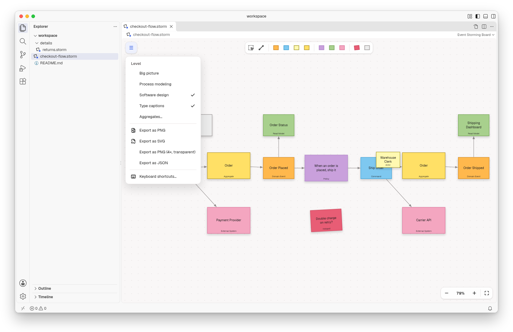
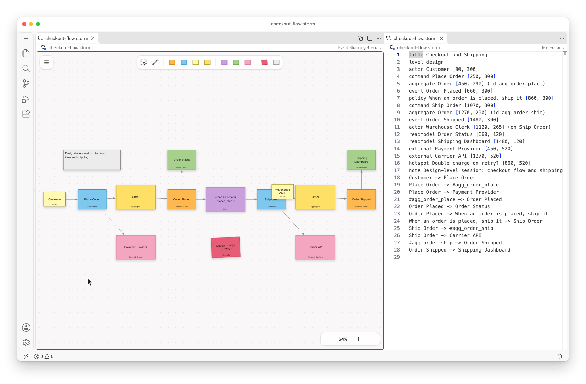
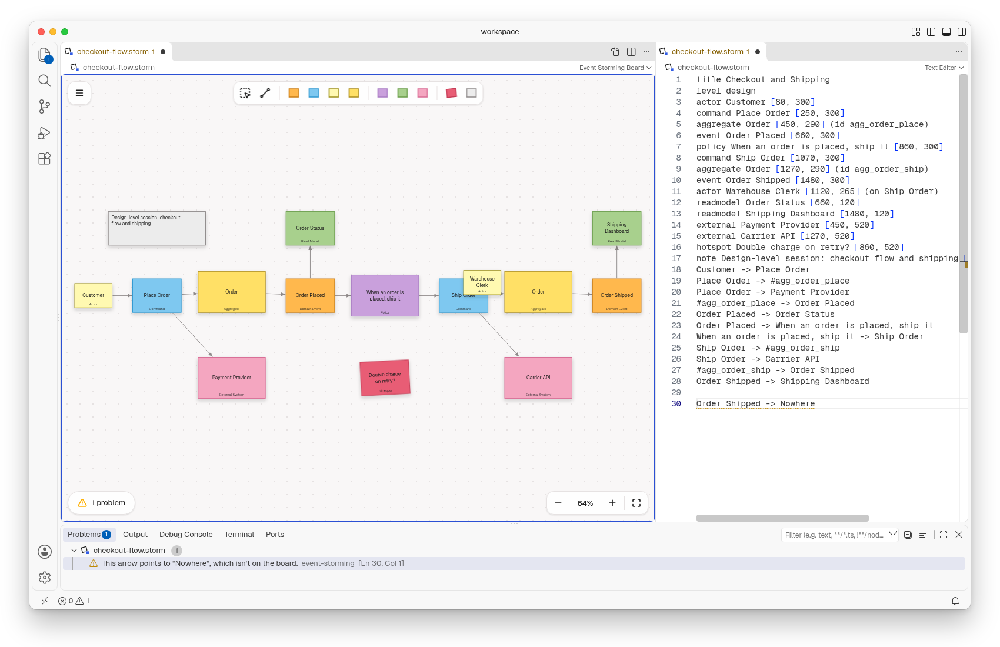

# Event Storming for VS Code

[](https://marketplace.visualstudio.com/items?itemName=miragon-gmbh.event-storming-modeler)
[](https://github.com/Miragon/modeler-suite/blob/main/modelers/event-storming/LICENSE)



Run [Event Storming](https://www.eventstorming.com) on a board in VS Code: domain events on a
timeline, the commands that trigger them, and the people, policies and systems around them. Each
board is a plain-text `.storm` file, so it stays in your own repository, next to your code.

Free and open source (MIT). No account, no telemetry, and it works offline.

## Get started

1. Run **Event Storming: New Board from Example** from the Command Palette (`Ctrl/Cmd+Shift+P`), or
   open any `.storm` file.
2. New to Event Storming? It is a workshop format for exploring a business domain with sticky
   notes. The walkthrough **Get Started with Event Storming** shows you how to read and edit a
   board, and Alberto Brandolini's book
   [Introducing EventStorming](https://leanpub.com/introducing_eventstorming) explains the method.

## Draw on the canvas



Place stickies from the palette: **Domain Event** orange, **Command** blue, **Actor** light yellow,
**Aggregate** yellow, **Policy** purple, **Read Model** green, **External System** pink and
**Hotspot** red, plus notes and drawings. Select a sticky to append, connect, change its type or
delete it. Time flows left to right, and arrows connect the stickies into a story. Undo and save
work as for any other file.

## Export for slides



Export a board as PNG or SVG from the menu, as a transparent PNG at four times the size for slides,
or as JSON. The `.storm` file stays the source you edit.

## Text and board side by side



**Event Storming: Open Source to the Side** shows the board's text next to the board. Type in the
text and the board follows. Move or edit a sticky and its line in the text changes.

The editor keeps the text in one order: stickies first, then arrows, then comments. The first
canvas edit in a hand-written file may move lines into that order and drop blank lines.

## Mistakes show up as problems



Lines the editor can't use are listed in the **Problems** view in plain words, and they stay in the
file as written. The board keeps drawing everything else.

## Workshop levels and aggregates

**Level** in the menu switches between big picture, process modeling and software design. Each
level offers the stickies of that workshop format. **Aggregates…** lists every aggregate with the
commands that lead into it and the events that follow, and selects its stickies on the board.

A sticky created or renamed on the canvas gets a stable id in the text, such as
`(id event_k3x9q2ab)`, so it stays the same sticky after a reload.

## Boards written by an AI agent

A board is a text file, so a coding agent can write it, and the board redraws when the file
changes. For Claude Code, the `event-storming-modeler` plugin teaches the method and the `.storm`
format, so you can ask Claude to draft a board from your notes or to review one:

```text
/plugin marketplace add Miragon/modeler-suite
/plugin install event-storming-modeler@modeler-suite
```

## Good to know

- Needs VS Code 1.96 or later on the desktop. VS Code for the Web is not supported.
- There is no live co-editing. Share boards through Git, or open them in the
  [web app](https://event-storming.modeler.miragon.io).
- **Keyboard shortcuts…** in the board's menu lists every key and gesture.
- The board stays light in dark themes.

## Links

[Changelog](https://github.com/Miragon/modeler-suite/blob/main/modelers/event-storming/apps/vscode/CHANGELOG.md)
·
[Report an issue](https://github.com/Miragon/modeler-suite/issues)
·
[Source and contributing](https://github.com/Miragon/modeler-suite/blob/main/modelers/event-storming/CONTRIBUTING.md)
·
[Third-party licences](https://github.com/Miragon/modeler-suite/blob/main/modelers/event-storming/apps/vscode/THIRD_PARTY_NOTICES.md)

Made by [Miragon](https://www.miragon.io). MIT licence.
