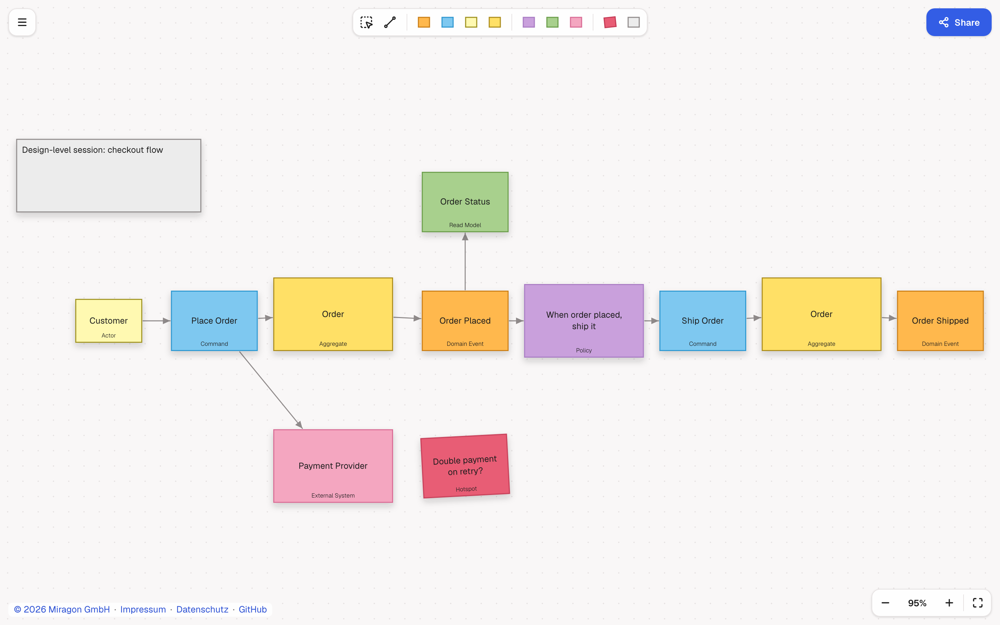

# Event Storming Modeler: Web App

[](https://github.com/Miragon/modeler-suite/blob/main/modelers/event-storming/LICENSE)

A browser editor for [Event Storming](https://www.eventstorming.com/) boards. Nothing to install: share boards as links, open or drop
`.storm`, `.json` and `.txt` files, and export PNG (Geist embedded, or a system font with a
warning), SVG, transparent 4× PNG, JSON and `.storm`. Replacing a board can be undone; import
problems are listed under the problems pill. "Aggregates…" lists each named aggregate with its
commands and events and selects its stickies.

**[Live demo](https://event-storming.modeler.miragon.io)**



## Run locally

From the root of the Miragon modeler suite:

```bash
npm ci && npm run build:shared            # once
npm run event-storming dev:webapp         # named HTTPS URL via Portless; one-time setup in the suite's CONTRIBUTING.md
npm run event-storming dev:webapp:plain   # plain Vite, http://127.0.0.1:5180
```

## License

MIT
