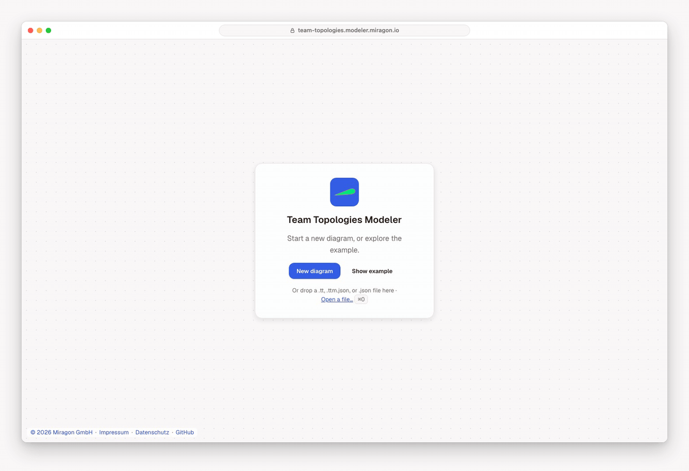

# Team Topologies Modeler

[](LICENSE)
[](https://marketplace.visualstudio.com/items?itemName=miragon-gmbh.team-topologies-modeler)
[](https://www.npmjs.com/package/@miragon/team-topologies-renderer)

Draw your organisation with [Team Topologies](https://teamtopologies.com/): the four team types and
three interaction modes from the book by Matthew Skelton and Manuel Pais. Use it to picture how
your teams work today, to discuss changes, and to keep the result as a plain `.tt` or `.ttm.json`
file next to your code.

Free and open source (MIT). No account, and it works offline. Part of the
[Miragon modeler suite](../../README.md).

**[Try the web app →](https://team-topologies.modeler.miragon.io)**



## Use it where you work

- **In the browser:** the [web app](https://team-topologies.modeler.miragon.io) needs no install
  and keeps your diagram in the browser. **Share** copies a link that holds the whole diagram.
  Export PNG, SVG or JSON.
- **In VS Code:** the [Team Topologies Modeler](apps/vscode/README.md) opens `.tt` and `.ttm.json`
  files as diagrams, with the JSON side by side and problems in the Problems view. Editable
  pictures (`*.tt.png`) drop into a wiki or a README and still open as diagrams.
- **In Orca:** the [Orca plugin](apps/orca/README.md) shows each change your coding agent writes
  to the diagram as it happens.
- **With Claude Code:** the
  [`team-topologies-modeler` plugin](plugins/team-topologies-modeler/README.md) teaches Claude the
  method and the file format, with a checker for the files it writes, so it can design a topology
  from your organisation or review one.

Press `?` in any of them for every key and gesture.

## The notation

Shapes, colours and stroke styles follow the official
[Team-Shape-Templates](https://github.com/TeamTopologies/Team-Shape-Templates). Team shapes are
solid (long-lived); interaction shapes are dashed (short-lived). Every element differs by shape as
well as colour, so diagrams stay readable with colour-vision deficiency.

| Team type             | Shape                        | Owns or does                                |
| --------------------- | ---------------------------- | ------------------------------------------- |
| Stream-aligned        | horizontal rounded rectangle | a slice of the product, end to end          |
| Enabling              | vertical rounded rectangle   | helps other teams grow a capability         |
| Complicated subsystem | octagon                      | a part that needs deep specialist knowledge |
| Platform              | square-cornered rectangle    | internal services other teams build on      |

The interaction modes sit where two teams meet: collaboration (parallelogram), X-as-a-Service
(triangle, pointing from provider to consumer) and facilitating (circle). Add the flow of change
and free-text annotations, on their own or attached to an element. Resize a team to show its
cognitive load. The legend in the menu explains every shape.

## The file

A `.tt` / `.ttm.json` file is small, stable JSON that diffs cleanly. Interactions are shapes placed
over the boundary between the teams they relate to:

```jsonc
{
  "version": 3,
  "title": "Online shop team topology",
  "nodes": [
    {
      "id": "team_checkout",
      "type": "stream-aligned",
      "label": "Checkout & Payments",
      "position": { "x": 560, "y": 202 },
      "size": { "width": 240, "height": 96 },
    },
  ],
  "interactions": [
    {
      "id": "int_platform_checkout",
      "mode": "x-as-a-service",
      "position": { "x": 636, "y": 286 },
      "size": { "width": 88, "height": 78 },
    },
  ],
  "flows": [],
  "annotations": [],
}
```

The full format is in [`@miragon/team-topologies-schema-model`](packages/schema-model/README.md).

## Build on it

Embed diagrams in your own app with the npm packages
[`@miragon/team-topologies-renderer`](packages/renderer/README.md) (viewer and modeler) and
[`@miragon/team-topologies-schema-model`](packages/schema-model/README.md) (the file format):

```bash
npm install @miragon/team-topologies-renderer
```

Building, running and testing the modeler is in [CONTRIBUTING.md](CONTRIBUTING.md). Issues go to
[Miragon/modeler-suite](https://github.com/Miragon/modeler-suite/issues).

## Licence

[MIT](LICENSE). The bundled Lucide icons of the modeler shell are ISC (partly Feather, MIT); the
web app's bundle keeps their licence comment. "Team Topologies" is a trademark of Team Topologies
Ltd; this is an independent, unaffiliated tool that implements their openly published notation.
