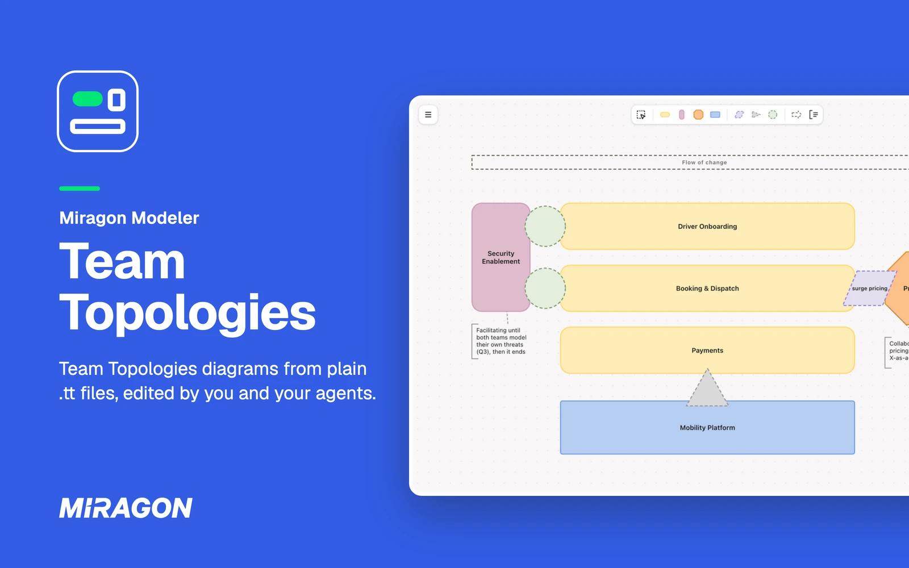
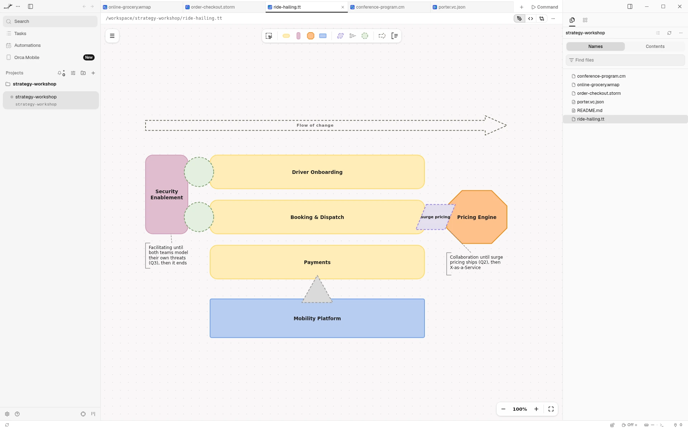
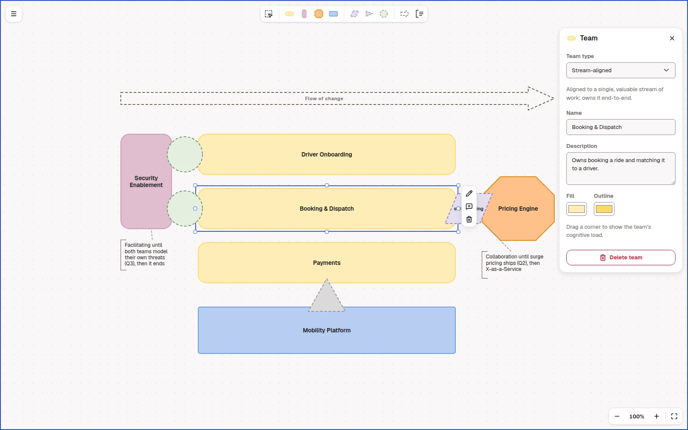
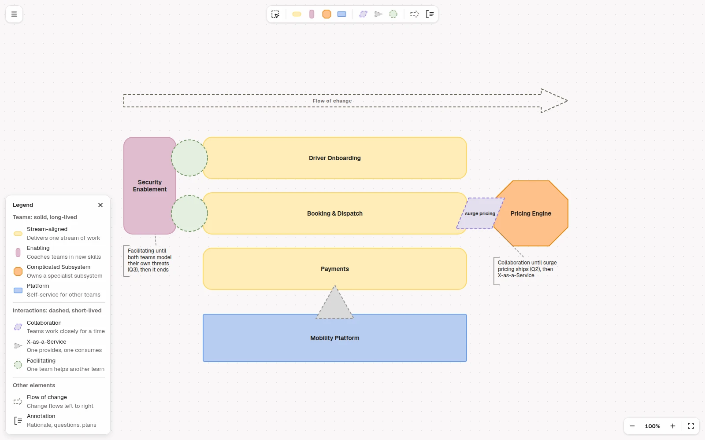

# Team Topologies for Orca

[](https://github.com/Miragon/modeler-suite/blob/main/modelers/team-topologies/LICENSE)



See the team topologies your agent writes, and edit them right next to it. In
[Orca](https://www.onorca.dev), a `.tt` or `.ttm.json` file opens as a
[Team Topologies](https://teamtopologies.com/) diagram instead of text: the teams, how they
interact, and the flow of change. The file stays plain JSON, so your agent reads and writes it
like code.

Free and open source (MIT). No account, no network access, and it sees only the file you open.

**[Open in Orca](https://www.onorca.dev/plugins/miragon/orca-modelers/team-topologies-modeler)**

## Get started

1. Turn on plugins in Orca once: Settings → Plugins → **Turn on plugins**.
2. Open the plugin's page with the link above, or search for **Miragon** in Settings → Plugins,
   and install it. New releases reach you through Orca.
3. Click **Try it** to open an example team topology, or open any `.tt` or `.ttm.json` file. **+**
   in the tab bar starts a new one from the example too.
4. New to Team Topologies? It organises software teams for a fast flow of change, with four team
   types and three interaction modes.

## Live while your agent writes



Each change your agent makes to the file shows up on the canvas right away. If it writes while you
have unsaved edits, the editor merges its changes with yours when they touch different teams,
interactions, flows or annotations. Only when you both changed the same element does Orca ask
whether to reload the file or keep yours.

## Draw on the canvas



Place teams, interactions, the flow of change and annotations from the palette. Drop an
interaction where two teams meet. Select an element to rename, annotate or delete it, and edit its
type, name, description and colours in the inspector on the right. Undo and save work as you
expect.

## Read the shapes



- **Team types:** stream-aligned (horizontal rounded rectangle) owns a slice of the product end to
  end; enabling (vertical rounded rectangle) helps other teams grow a capability;
  complicated-subsystem (octagon) owns a part that needs deep specialist knowledge; platform
  (square-cornered rectangle) provides internal services.
- **Interaction modes**, where two teams meet: collaboration (parallelogram), X-as-a-Service
  (triangle, pointing from provider to consumer) and facilitating (circle).
- **Legend** in the menu explains every shape on the diagram.

## Export for slides

Export a diagram as PNG or SVG from the menu. Orca's save dialog asks where to put the file. The
`.tt` file stays the source you edit.

## Let your agent write the diagrams

For Claude Code, the `team-topologies-modeler` plugin teaches your agent the method and the file
format, with a checker for the files it writes, so you can ask it to design a topology from your
organisation or to review one:

```text
/plugin marketplace add Miragon/modeler-suite
/plugin install team-topologies-modeler@modeler-suite
```

## Good to know

- Needs the Orca desktop app, version 1.4.252 or later.
- Orca shows no problems list for the editor. While the JSON can't be read, the diagram shows the
  last valid version.
- Editable pictures (`*.tt.png`) open in [VS Code](../vscode/README.md) and the web app, not yet
  in Orca.
- The diagram stays light in Orca's dark theme. The team colours follow the official Team
  Topologies templates.
- **Keyboard shortcuts…** in the diagram's menu lists every key and gesture.
- Also available for [VS Code](../vscode/README.md) and as a
  [web app](https://team-topologies.modeler.miragon.io) that makes share links.

## Links

[Changelog](../../CHANGELOG.md) · [Report an issue](https://github.com/Miragon/modeler-suite/issues) ·
[Source and contributing](../../../../CONTRIBUTING.md#orca-plugins) ·
[All Miragon modelers for Orca](https://github.com/Miragon/orca-modelers)

Made by [Miragon](https://www.miragon.io). MIT licence. "Team Topologies" is a trademark of Team
Topologies Ltd; this is an independent tool that implements their openly published notation.
