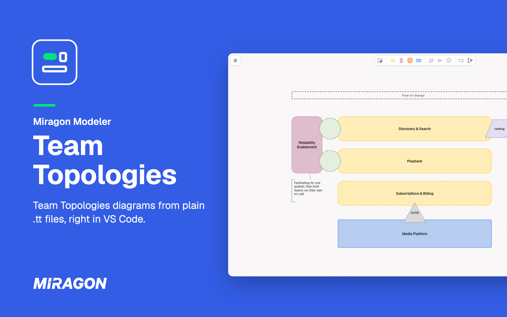
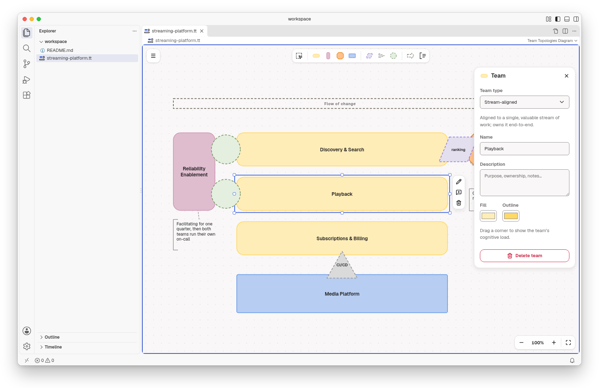
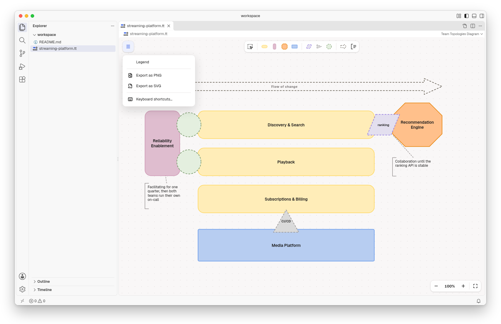
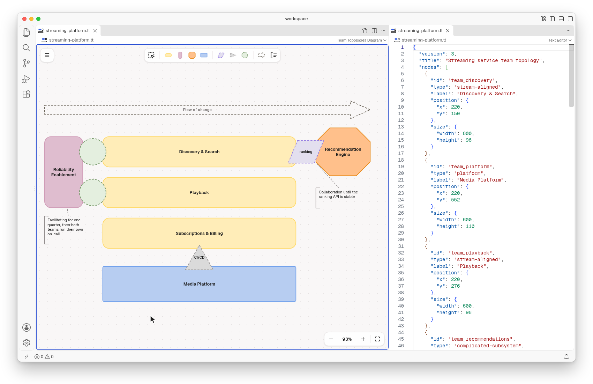
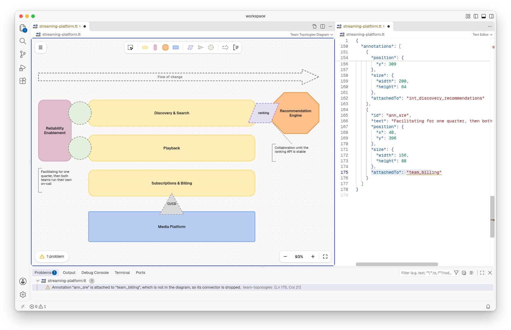

# Team Topologies for VS Code

[](https://marketplace.visualstudio.com/items?itemName=miragon-gmbh.team-topologies-modeler)
[](https://github.com/Miragon/modeler-suite/blob/main/modelers/team-topologies/LICENSE)



Draw your organisation with [Team Topologies](https://teamtopologies.com/) in VS Code: the teams,
how they interact, and the flow of change. Each diagram is a plain `.tt` or `.ttm.json` file
(deterministic JSON), so it stays in your own repository, next to your code.

Free and open source (MIT). No account, no telemetry, and it works offline.

## Get started

1. Run **Team Topologies: New Diagram from Example** from the Command Palette (`Ctrl/Cmd+Shift+P`),
   or open any `.tt` or `.ttm.json` file.
2. New to Team Topologies? It organises software teams for a fast flow of change, with four team
   types and three interaction modes. The walkthrough **Get Started with Team Topologies Modeler**
   shows you how to read and edit a diagram.

## Draw on the canvas



Place teams, interactions, the flow of change and annotations from the palette. Drop an
interaction where two teams meet. Select an element to rename, annotate or delete it, and edit its
type, name, description and colours in the inspector on the right. Undo and save work as for any
other file.

## Read the shapes

- **Team types:** stream-aligned (horizontal rounded rectangle) owns a slice of the product end to
  end; enabling (vertical rounded rectangle) helps other teams grow a capability;
  complicated-subsystem (octagon) owns a part that needs deep specialist knowledge; platform
  (square-cornered rectangle) provides internal services.
- **Interaction modes**, where two teams meet: collaboration (parallelogram), X-as-a-Service
  (triangle, pointing from provider to consumer) and facilitating (circle).
- **Legend** in the menu explains every shape on the diagram.

## Export for slides



Export a diagram as PNG or SVG from the menu. The `.tt` file stays the source you edit.

## Text and diagram side by side



**Team Topologies: Open Source to the Side** shows the diagram's JSON next to the diagram. Type in
the JSON and the diagram follows. Edit the diagram and the JSON changes.

## Mistakes show up as problems



The **Problems** view says what is wrong in the file. While the JSON can't be read, the diagram
shows the last valid version read-only, and the text stays as you wrote it.

## Diagrams as editable images

A `*.tt.png` file is a picture that carries its diagram, so you can drop it into a wiki or a README
and still open it here to edit. Start one with **Team Topologies: New Empty Diagram (embedded
PNG)** and save once.

## Diagrams written by an AI agent

A diagram is a text file, so a coding agent can write it, and the diagram redraws when the file
changes. For Claude Code, the `team-topologies-modeler` plugin teaches the method and the file
format, with a checker for the files it writes, so you can ask Claude to design a topology from
your organisation or to review one:

```text
/plugin marketplace add Miragon/modeler-suite
/plugin install team-topologies-modeler@modeler-suite
```

## Good to know

- Needs VS Code 1.96 or later on the desktop. VS Code for the Web is not supported.
- There is no live co-editing. Share diagrams through Git, or open them in the
  [web app](https://team-topologies.modeler.miragon.io).
- **Keyboard shortcuts…** in the diagram's menu lists every key and gesture.
- The diagram stays light in dark themes. The team colours follow the official Team Topologies
  templates.

## Links

[Changelog](https://github.com/Miragon/modeler-suite/blob/main/modelers/team-topologies/apps/vscode/CHANGELOG.md)
·
[Report an issue](https://github.com/Miragon/modeler-suite/issues)
·
[Source and contributing](https://github.com/Miragon/modeler-suite/blob/main/modelers/team-topologies/CONTRIBUTING.md)
·
[Third-party licences](https://github.com/Miragon/modeler-suite/blob/main/modelers/team-topologies/apps/vscode/THIRD_PARTY_NOTICES.md)

Made by [Miragon](https://www.miragon.io). MIT licence.
