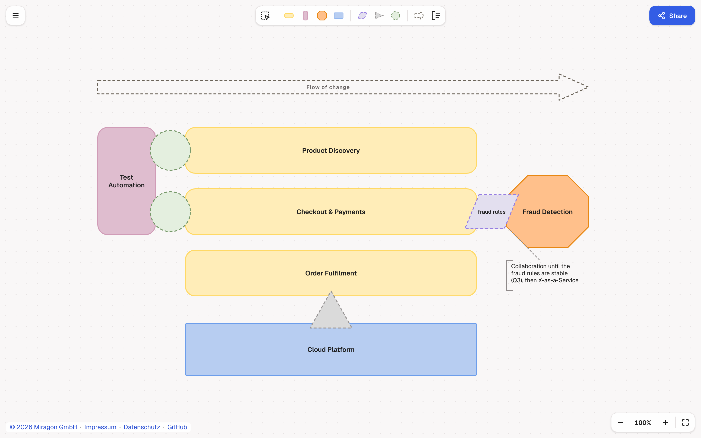

# Team Topologies Modeler: Web App

[](https://github.com/Miragon/modeler-suite/blob/main/modelers/team-topologies/LICENSE)

Draw [Team Topologies](https://teamtopologies.com/) diagrams in your browser. Nothing to install and
no backend: your diagram stays in your browser, and you share it as a link.

**[Live demo](https://team-topologies.modeler.miragon.io)**



## What you can do

- **Start** with a new diagram, the example, or a `.tt` / `.ttm.json` / `.json` file (open it or
  drop it anywhere on the page).
- **Draw** teams and interactions from the palette, move and resize them (resize a team to show
  cognitive load), and edit names in place. Select several with `Cmd/Ctrl+A`, Shift+drag or
  Shift+click.
- **Annotate** with free-text notes, on their own or attached to an element.
- **Inspect** the selection on the right: team type or interaction mode, name, description, colours.
- **Share** copies a link that holds the whole diagram. Opening it restores the diagram.
- **Export** PNG, SVG or JSON (`Cmd/Ctrl+S`), named after the diagram's title.
- **Undo anything:** replacing a diagram offers **Undo**, and **Restore previous diagram** brings
  the last one back later.
- **Autosave:** every change is kept in the browser, so a reload brings your diagram back.
- The legend explains every shape; `?` lists the keyboard shortcuts. Works offline.

## Run it locally

From the root of the [Miragon modeler suite](https://github.com/Miragon/modeler-suite):

```bash
npm ci && npm run build:shared
npm run team-topologies dev:webapp:plain   # http://127.0.0.1:5181
```

More in [CONTRIBUTING.md](../../CONTRIBUTING.md).

## License

[MIT](../../LICENSE). The bundled Lucide icons of the modeler shell are ISC (partly Feather, MIT); the
bundle keeps their licence comment.
