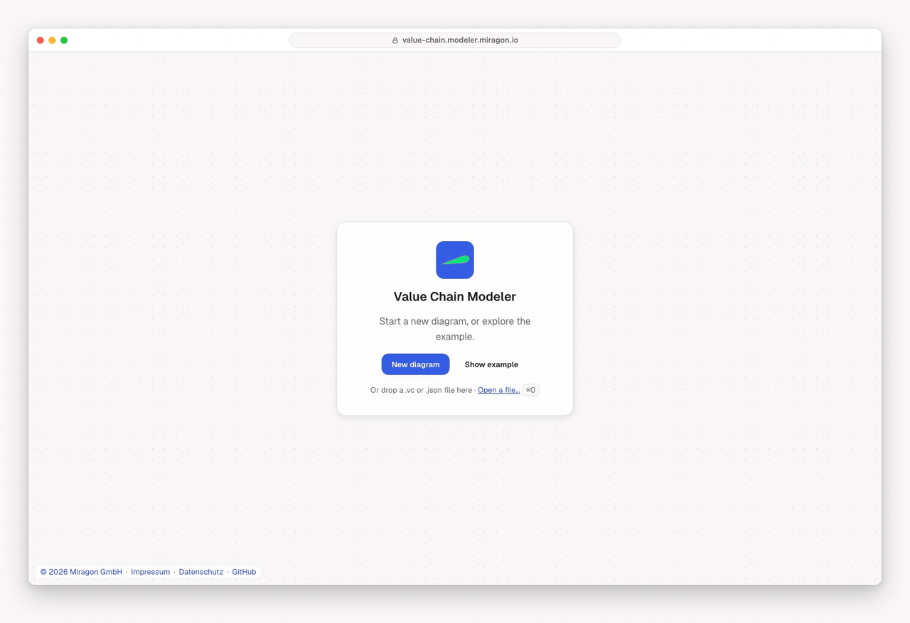

# Value Chain Modeler

Draw value chain diagrams
([Wertschöpfungskettendiagramme](https://de.wikipedia.org/wiki/Wertsch%C3%B6pfungskettendiagramm),
the ARIS-style value-added chain): which steps create value for a business, in which order, how
they break down into sub-steps, and which organizational units are responsible for them. Use it to
get a one-page overview of a process landscape before you model single processes in detail.

## What you can draw

- **Step**: a right-pointing chevron for a value-adding activity.
- **Organizational unit**: an ellipse, assigned to a step.
- **is predecessor of**: one step follows another (dashed arrow).
- **is process-oriented superior**: a step breaks down into sub-steps (solid arrow).
- **assignment**: links an organizational unit to its step (plain line).

## Try it

- **In VS Code**: install the [Value Chain Modeler extension](apps/vscode/README.md) and open or
  create a `.vc` / `.vc.json` file.
- **In the browser**: the web app opens with an example or a new diagram, saves your last diagram
  in the browser and exports PNG, SVG and JSON. **Share** copies a link that contains the whole
  diagram.

Diagrams are plain JSON files, so they fit into Git, reviews and diffs like any other text file.

## Learn more

- [VS Code extension](apps/vscode/README.md): features, commands and shortcuts.
- [`@miragon/value-chain-renderer`](packages/renderer/README.md): embed the editor or viewer in
  your own app.
- [`@miragon/value-chain-schema-model`](packages/schema-model/README.md): the file format and its
  validation.
- [CONTRIBUTING.md](CONTRIBUTING.md): build, run and test the modeler.

Part of the [Miragon modeler suite](../../README.md). Issues go to
[Miragon/modeler-suite](https://github.com/Miragon/modeler-suite/issues).
