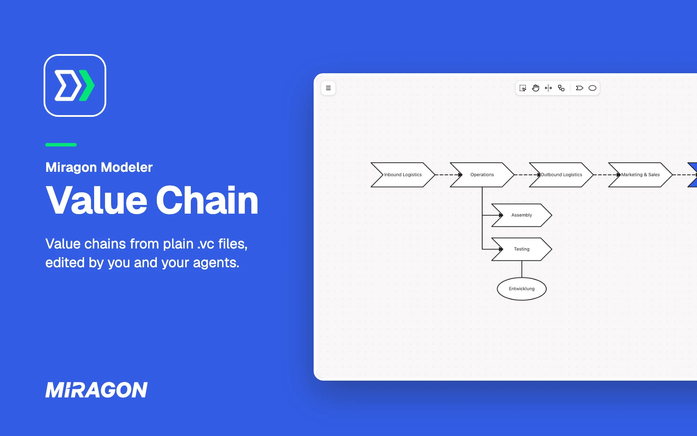
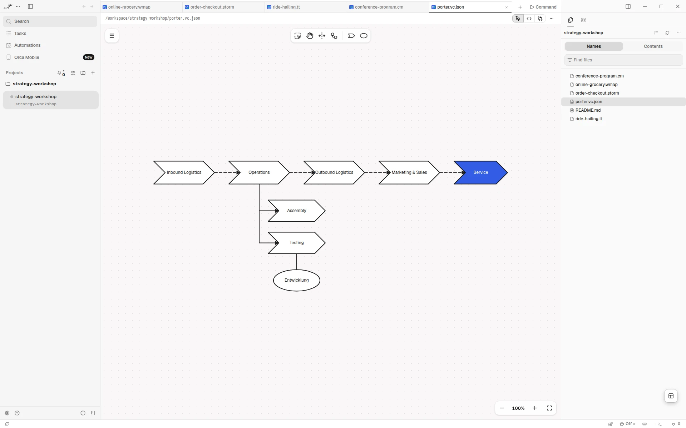
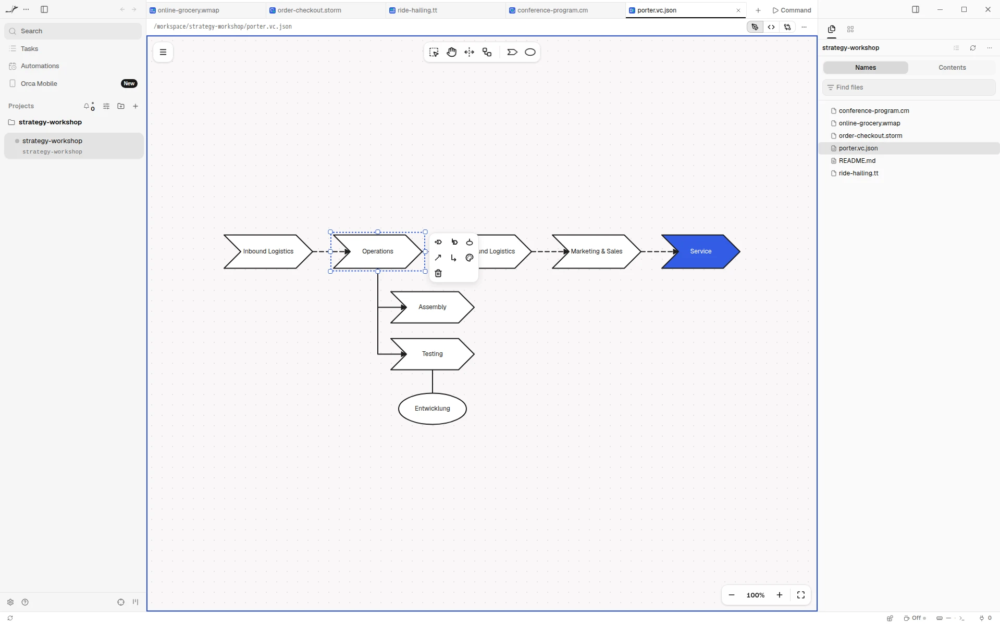
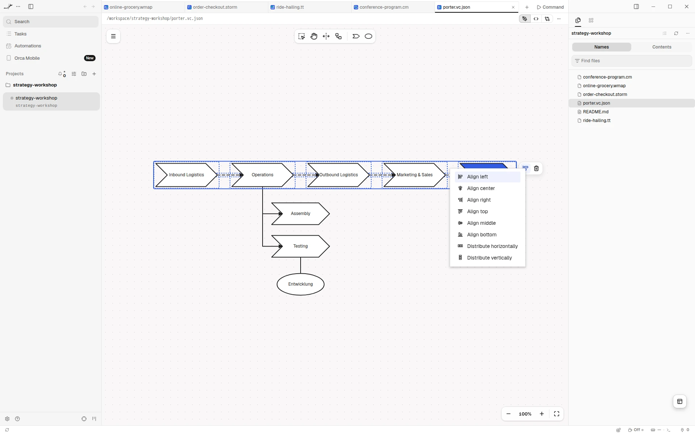

# Value Chain for Orca

See the value chains your agent writes, and edit them right next to it. In
[Orca](https://www.onorca.dev), a `.vc` or `.vc.json` file opens as a value chain diagram in the
style of ARIS (Wertschöpfungskettendiagramme) instead of text: the steps that create value, how
they break down, and the organizational units that own them. The file stays plain JSON, so your
agent reads and writes it like code.

Free and open source (MIT). No account, no network access, and it sees only the file you open.

**[Open in Orca](https://www.onorca.dev/plugins/miragon/orca-modelers/value-chain-modeler)**

## Get started

1. Turn on plugins in Orca once: Settings → Plugins → **Turn on plugins**.
2. Open the plugin's page with the link above, or search for **Miragon** in Settings → Plugins,
   and install it. New releases reach you through Orca.
3. Click **Try it** to open an example value chain, or open any `.vc` or `.vc.json` file. **+** in
   the tab bar starts a new one from the example too.
4. New to value chains? A value chain shows the steps that create value, in order from left to
   right, broken down into sub-steps, with the organizational units that own them.

## Live while your agent writes

Each change your agent makes to the file shows up on the canvas right away. If it writes while you
have unsaved edits, the editor merges its changes with yours when they touch different steps, org
units or connections. Only when you both changed the same element does Orca ask whether to reload
the file or keep yours.

## Draw on the canvas

Place steps and organizational units from the palette. Select a step to append the next step, a
sub-step or an organizational unit, connect it, colour it or delete it. Steps in order are
connected as "is predecessor of", sub-steps as "is process-oriented superior", and units are
assigned to the steps they own. Undo and save work as you expect.

## Align in one go

Select several steps to align them left, centre, right, top, middle or bottom, or to distribute
them evenly.

## Export for slides

Export a diagram as PNG or SVG from the menu. Orca's save dialog asks where to put the file. The
`.vc` file stays the source you edit.

## Good to know

- Needs the Orca desktop app, version 1.4.252 or later.
- Orca shows no problems list for the editor. While the JSON can't be read, the diagram shows the
  last valid version.
- The diagram stays light in Orca's dark theme.
- **Keyboard shortcuts…** in the diagram's menu lists every key and gesture.
- Also available for [VS Code](../vscode/README.md).

## Links

[Changelog](CHANGELOG.md) · [Report an issue](https://github.com/Miragon/modeler-suite/issues) ·
[Source and contributing](../../../../CONTRIBUTING.md#orca-plugins) ·
[All Miragon modelers for Orca](https://github.com/Miragon/orca-modelers)

Made by [Miragon](https://www.miragon.io). MIT licence.
