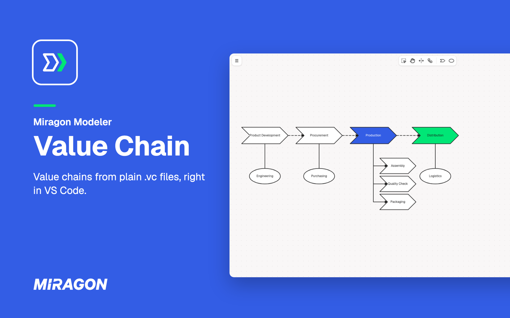
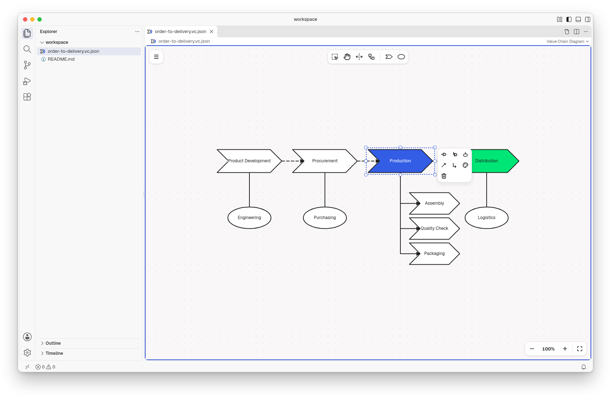
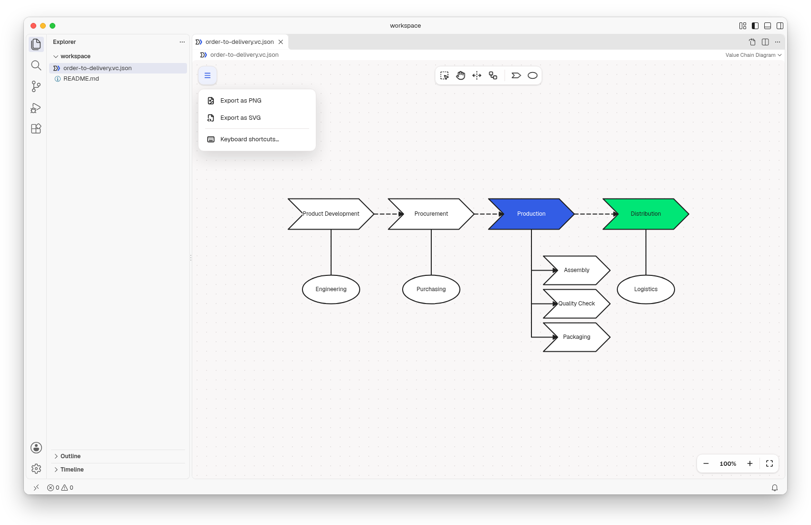
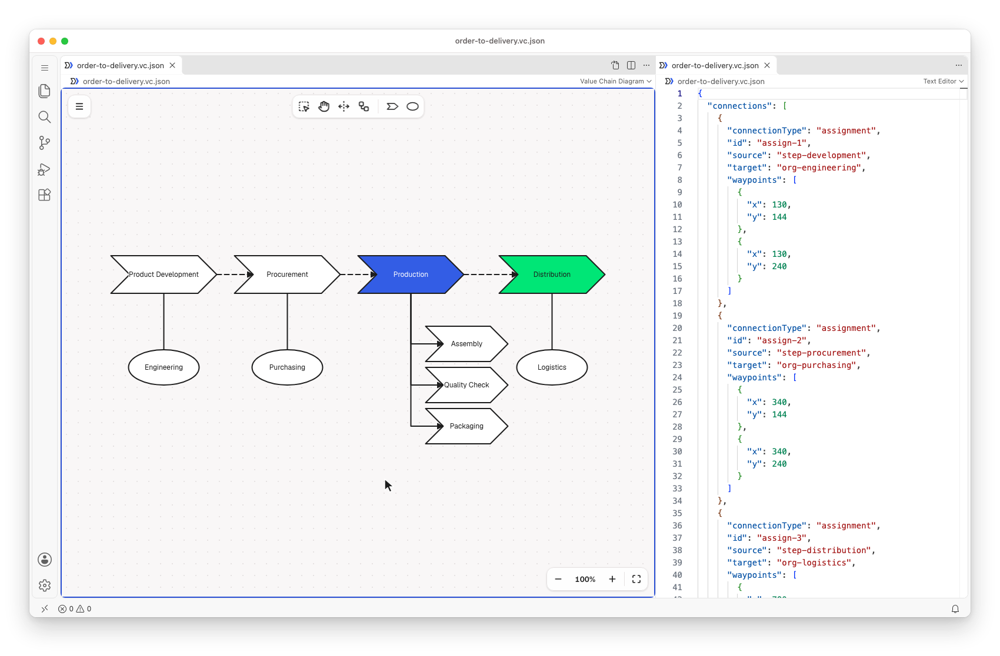
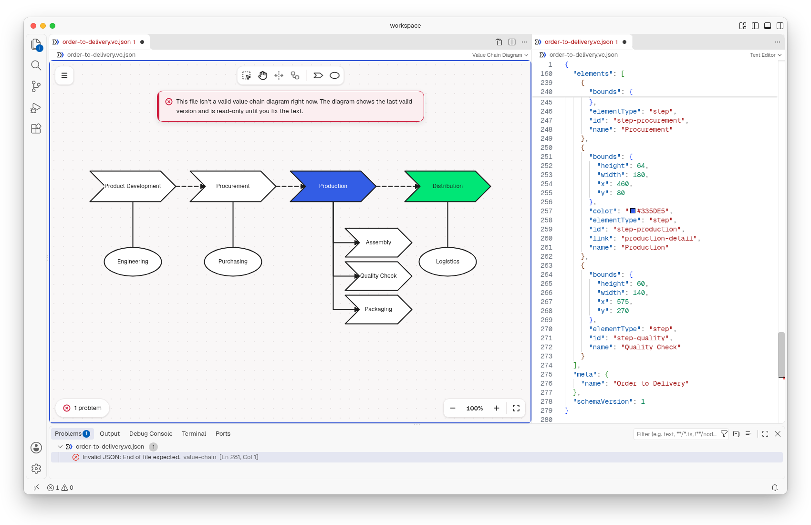

# Value Chain for VS Code

Map the value-adding steps of a business and who owns them, in VS Code: value chain diagrams in the
style of ARIS (Wertschöpfungskettendiagramme), rooted in Porter's value chain. Each diagram is a
plain `.vc` or `.vc.json` file (deterministic JSON), so it stays in your own repository, next to
your code.

Free and open source (MIT). No account, no telemetry, and it works offline.

## Get started

1. Run **Value Chain: New Value Chain Diagram from Example** from the Command Palette
   (`Ctrl/Cmd+Shift+P`), or open any `.vc` or `.vc.json` file.
2. New to value chains? A value chain shows the steps that create value, in order from left to
   right, broken down into sub-steps, with the organizational units that own them. The walkthrough
   **Get Started with Value Chains** shows you how to read and edit one.

## Draw on the canvas

Place steps and organizational units from the palette. Select a step to append the next step, a
sub-step or an organizational unit, connect it, colour it, align several steps or delete it. Steps
in order are connected as "is predecessor of", sub-steps as "is process-oriented superior", and
units are assigned to the steps they own. Undo and save work as for any other file.

## Export for slides

Export a diagram as PNG or SVG from the menu. The `.vc` file stays the source you edit.

## Text and diagram side by side

**Value Chain: Open Source to the Side** shows the diagram's JSON next to the diagram. Type in the
JSON and the diagram follows. Edit the diagram and the JSON changes.

## Mistakes show up as problems

The **Problems** view points at what is wrong in the file. While the JSON can't be read, the
diagram shows the last valid version read-only, and the text stays as you wrote it.

## Diagrams written by an AI agent

A diagram is a JSON file, so a coding agent can write it, and the diagram redraws when the file
changes.

## Good to know

- Needs VS Code 1.96 or later on the desktop. VS Code for the Web is not supported.
- There is no live co-editing. Share diagrams through Git.
- **Keyboard shortcuts…** in the diagram's menu lists every key and gesture.
- The diagram stays light in dark themes.

## Links

[Changelog](https://github.com/Miragon/modeler-suite/blob/main/modelers/value-chain/apps/vscode/CHANGELOG.md)
·
[Report an issue](https://github.com/Miragon/modeler-suite/issues)
·
[Source and contributing](https://github.com/Miragon/modeler-suite/blob/main/modelers/value-chain/CONTRIBUTING.md)
·
[Third-party licences](https://github.com/Miragon/modeler-suite/blob/main/modelers/value-chain/apps/vscode/THIRD_PARTY_NOTICES.md)

Made by [Miragon](https://www.miragon.io). MIT licence.
