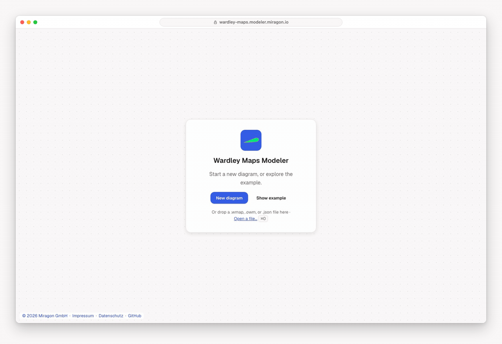

# Wardley Maps Modeler

[](LICENSE)
[](https://marketplace.visualstudio.com/items?itemName=miragon-gmbh.wardley-mapping-modeler)
[](https://www.npmjs.com/package/@miragon/wardley-renderer)

Draw [Wardley maps](https://learnwardleymapping.com/) on a canvas: what your users need, what that
depends on, and how mature each part is, from genesis to commodity. Each map is a plain-text
`.wmap` or `.owm` file in the [Online Wardley Maps](https://onlinewardleymaps.com/) format, so it
lives in your repository, shows up as a readable diff and evolves with the code it describes.

Free and open source (MIT). No account, and it works offline. Part of the
[Miragon modeler suite](../../README.md).

**[Try the web app →](https://wardley-maps.modeler.miragon.io)**



## Use it where you work

- **In the browser:** the [web app](https://wardley-maps.modeler.miragon.io) needs no install.
  Open or drop a `.wmap`, `.owm` or `.json` file, or paste OWM text. **Share** copies a link that
  holds the whole map; nothing is uploaded. Export PNG, SVG, JSON or `.wmap`.
- **In VS Code:** the [Wardley Mapping Modeler](apps/vscode/README.md) opens `.wmap` and `.owm`
  files as maps, with the text side by side, problems in the Problems view and links between maps.
- **In Orca:** the [Orca plugin](apps/orca/README.md) shows each change your coding agent writes
  to the map as it happens.
- **With Claude Code:** the [`wardley-maps-modeler` plugin](plugins/wardley-maps-modeler/README.md)
  teaches Claude the method and the format, so it can draft a map from your strategy notes or
  review one with colour-coded notes in the file.

Press `?` in any of them for every key and gesture.

## What you can draw

Components, users and anchors on the value chain; dependencies and flows; evolution with `evolve`
and inertia; pipelines; build, buy and outsource; markets and ecosystems; accelerators;
pioneers, settlers and town planners; notes, annotations and submaps that link to other maps.
**X-axis labels…** names the stages of evolution your way.

**Explore mode** (`E`) tells a map one step at a time: start at a component and reveal what it
needs and what needs it, a level or a whole chain at once, while the rest stays hidden. The file
stays as it is, and an export shows only what you revealed.

## Your existing maps

Maps from onlinewardleymaps.com open unchanged. Edit the map on the canvas and only the lines you
touched change: comments, blank lines and order stay as you wrote them.

```text
title Tea Shop
anchor Business [0.95, 0.63]
component Cup of Tea [0.79, 0.61]
component Kettle [0.43, 0.35]
evolve Kettle 0.62
Business -> Cup of Tea
```

<details>
<summary>Coverage of the OWM elements</summary>

| Element / syntax                                    | Drawn | Read and written |
| --------------------------------------------------- | :---: | :--------------: |
| Component `[visibility, maturity]`                  |  ✅   |        ✅        |
| Anchor / user                                       |  ✅   |        ✅        |
| Dependency `->`                                     |  ✅   |        ✅        |
| Flow `+>` / `+<>` / `+<` / `+'value'>`              |  ✅   |        ✅        |
| Evolution `evolve`                                  |  ✅   |        ✅        |
| Inertia                                             |  ✅   |        ✅        |
| Pipeline `[matStart, matEnd]` + v2 block `{ … }`    |  ✅   |        ✅        |
| Build / buy / outsource (incl. standalone lines)    |  ✅   |        ✅        |
| Market / ecosystem                                  |  ✅   |        ✅        |
| Accelerator / deaccelerator                         |  ✅   |        ✅        |
| Pioneers / settlers / town planners `[v1,m1,v2,m2]` |  ✅   |        ✅        |
| Note (multi-line, colour)                           |  ✅   |        ✅        |
| Annotation (incl. multi-position)                   |  ✅   |        ✅        |
| Submap + `url` definitions / `url(...)` references  |  ✅   |        ✅        |
| Comments `//` and `/* */`                           |  n/a  |        ✅        |
| `label [dx, dy]` offsets                            |  ✅   |        ✅        |
| `title` / `style` / `size` / `evolution` / `y-axis` |  ✅   |        ✅        |

</details>

## Build on it

Embed maps in your own app with the npm packages:

```bash
npm install @miragon/wardley-renderer
```

```ts
import { NavigatedViewer } from "@miragon/wardley-renderer";
import "@miragon/wardley-renderer/assets/wardley.css";

const viewer = new NavigatedViewer({ container: document.querySelector("#canvas")! });
await viewer.importDSL(`title Tea Shop
anchor Business [0.95, 0.63]
component Kettle [0.43, 0.35]
Business -> Kettle`);
const { svg } = await viewer.saveSVG();
```

| Package                                                  | What it is                                               |
| -------------------------------------------------------- | -------------------------------------------------------- |
| [`@miragon/wardley-renderer`](packages/renderer)         | diagram-js viewer and modeler, import and export         |
| [`@miragon/wardley-dsl`](packages/dsl)                   | OWM text ↔ model, lossless round-trip (DOM-free)         |
| [`@miragon/wardley-schema-model`](packages/schema-model) | Metamodel, Zod validation, deterministic JSON (DOM-free) |
| [`@miragon/wardley-transforms`](packages/transforms)     | Pure `WardleyMap → WardleyMap` transforms (DOM-free)     |

Building, running and testing the modeler is in [CONTRIBUTING.md](CONTRIBUTING.md). Issues go to
[Miragon/modeler-suite](https://github.com/Miragon/modeler-suite/issues).

## Licence

[MIT](LICENSE)
