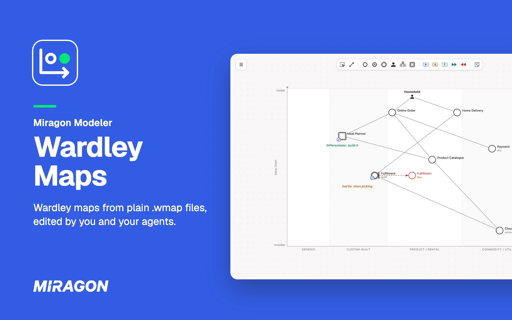
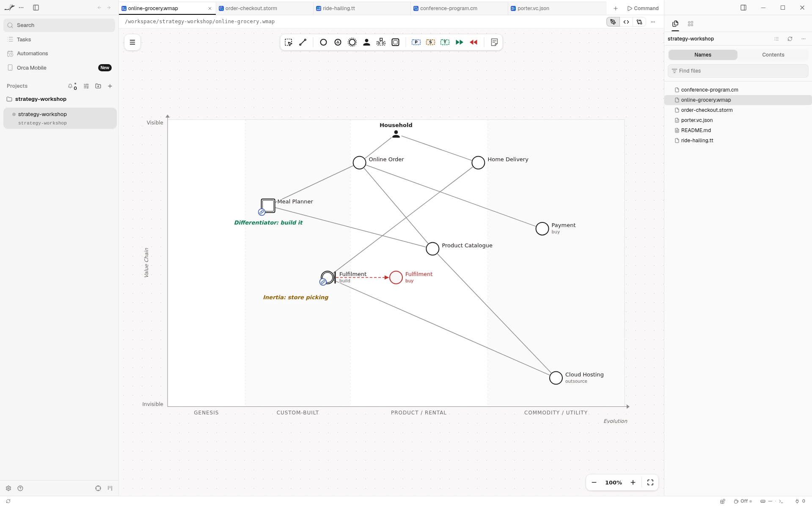
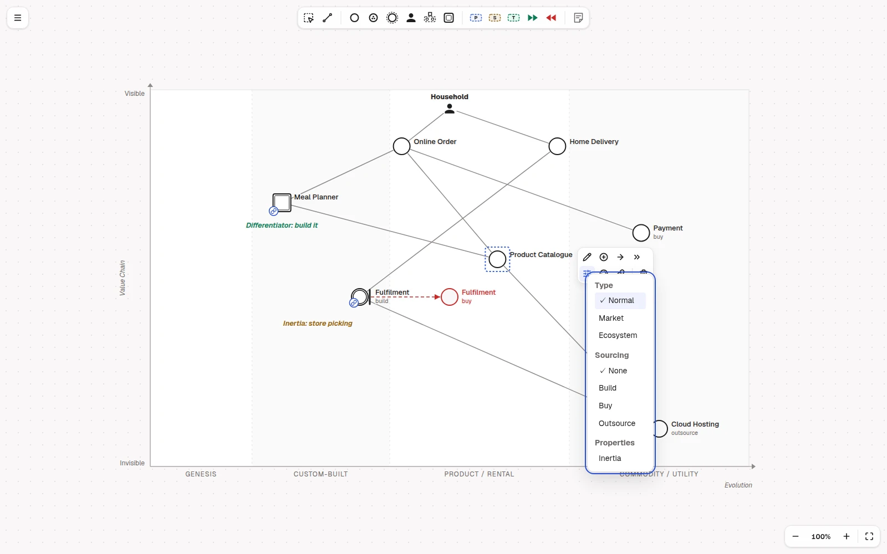
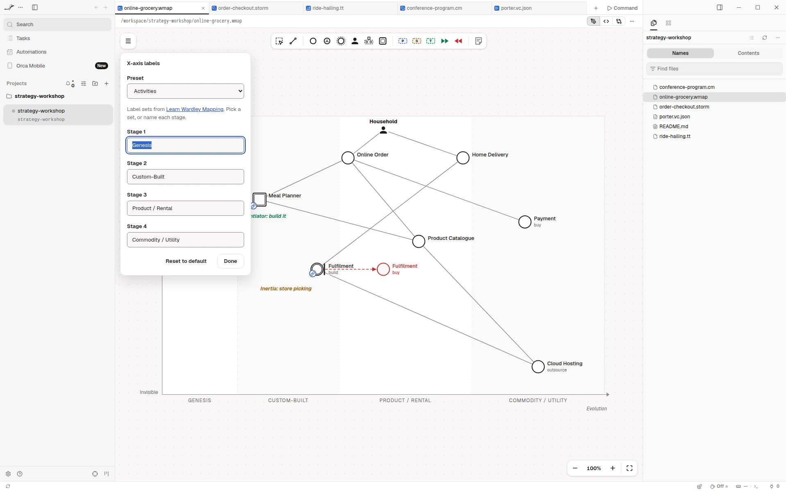

# Wardley Maps for Orca

[](https://github.com/Miragon/modeler-suite/blob/main/modelers/wardley-maps/LICENSE)



See the [Wardley maps](https://learnwardleymapping.com/) your agent writes, and edit them right
next to it. In [Orca](https://www.onorca.dev), a `.wmap` or `.owm` file opens as a map instead of
text. The file stays plain text in the [Online Wardley Maps](https://onlinewardleymaps.com/)
format, so your agent reads and writes it like code.

Free and open source (MIT). No account, no network access, and it sees only the file you open.

**[Open in Orca](https://www.onorca.dev/plugins/miragon/orca-modelers/wardley-maps-modeler)**

## Get started

1. Turn on plugins in Orca once: Settings → Plugins → **Turn on plugins**.
2. Open the plugin's page with the link above, or search for **Miragon** in Settings → Plugins,
   and install it. New releases reach you through Orca.
3. Click **Try it** to open an example map, or open any `.wmap` or `.owm` file. Maps from
   onlinewardleymaps.com open unchanged. **+** in the tab bar starts a new map from the example too.
4. New to Wardley Mapping? A map places what your users need by how visible it is to them (up and
   down) and how mature it is, from genesis to commodity (left to right).

## Live while your agent writes



Each change your agent makes to the file shows up on the canvas right away. If it writes while you
have unsaved edits, the editor merges its changes with yours when they touch different components,
dependencies or map settings. Your comments and the order of your lines stay. A component you rename
counts as a new one, so it conflicts only when your agent changed the old one. Only when you both
changed the same element does Orca ask whether to reload the file or keep yours.

## Draw on the canvas



Add components, users, notes and pipelines from the palette. Select an element to connect, evolve,
colour, link or delete it, and set its type, sourcing and inertia. Drag a component left or right
to move it along evolution. Undo and save work as you expect.

## Name the evolution stages your way



**X-axis labels…** in the menu names the four stages of evolution, from a preset or in your own
words. **Map size…** sets the size of the map.

## Export for slides

Export a map as PNG or SVG from the menu, or as a transparent PNG at four times the size for slides
and reports. Orca's save dialog asks where to put the file. The `.wmap` file stays the source you
edit.

## Let your agent write the maps

For Claude Code, the `wardley-maps-modeler` plugin teaches your agent the method and the format, so
you can ask it to draft a map from your strategy notes or to review one:

```text
/plugin marketplace add Miragon/modeler-suite
/plugin install wardley-maps-modeler@modeler-suite
```

## Good to know

- Needs the Orca desktop app, version 1.4.252 or later.
- A link to a web page opens in your browser after Orca asks. A link to another map does not open,
  as Orca lets no editor open a file: pick the map in Orca's file tree.
- Orca shows no problems list for the editor. Lines it can't read stay in the file as written,
  and the map keeps drawing everything else.
- The editor stays light in Orca's dark theme.
- **Keyboard shortcuts…** in the editor's menu lists every key and gesture.
- Also available for [VS Code](../vscode/README.md) and as a
  [web app](https://wardley-maps.modeler.miragon.io) that makes share links.

## Links

[Changelog](CHANGELOG.md) · [Report an issue](https://github.com/Miragon/modeler-suite/issues) ·
[Source and contributing](../../../../CONTRIBUTING.md#orca-plugins) ·
[All Miragon modelers for Orca](https://github.com/Miragon/orca-modelers)

Made by [Miragon](https://www.miragon.io). MIT licence.
