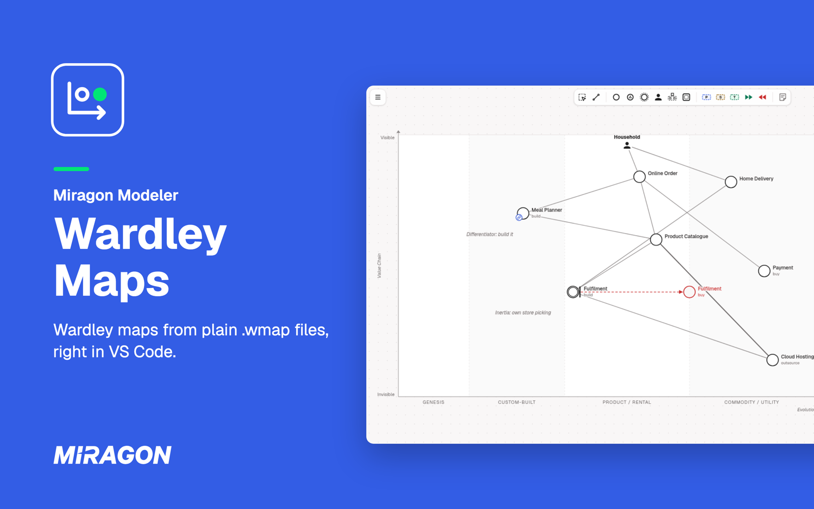
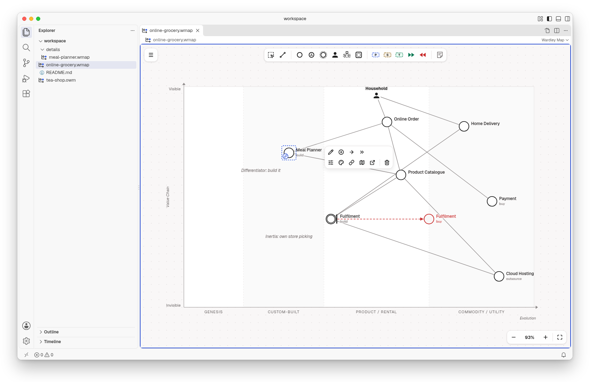
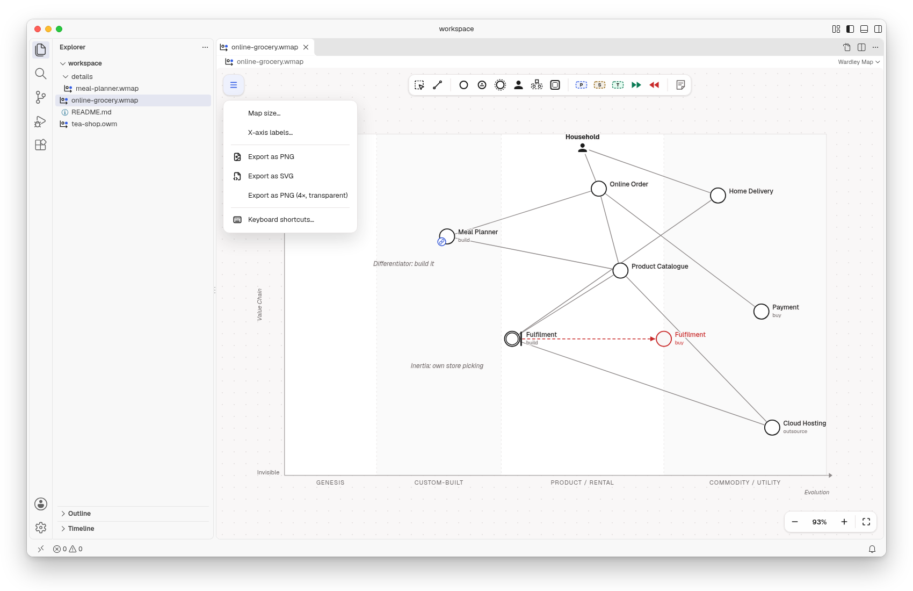
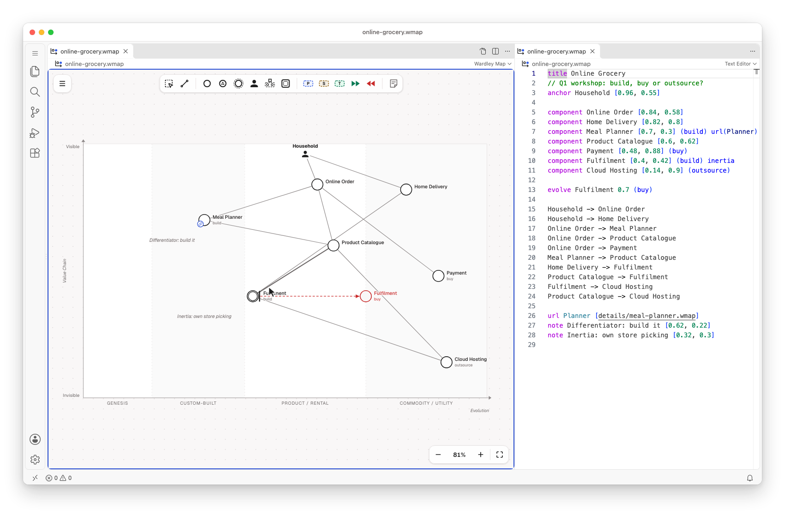
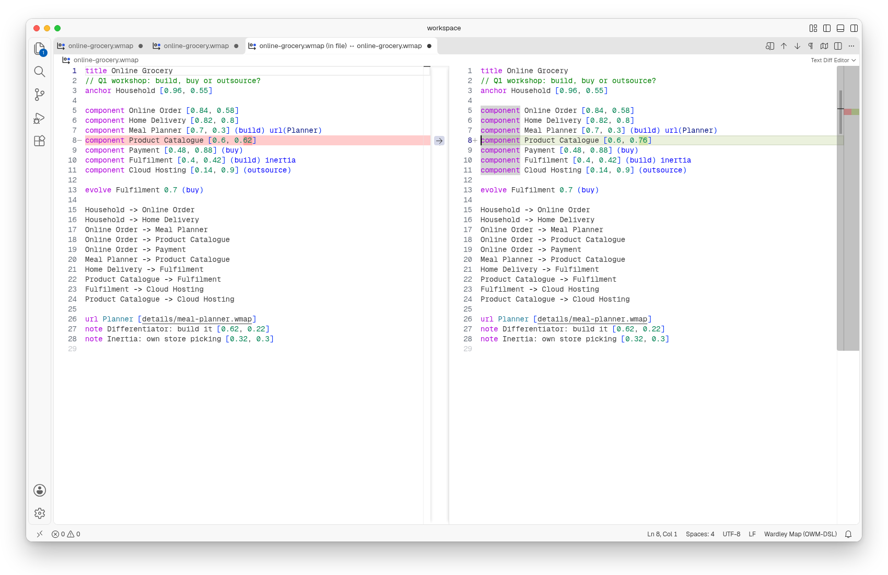
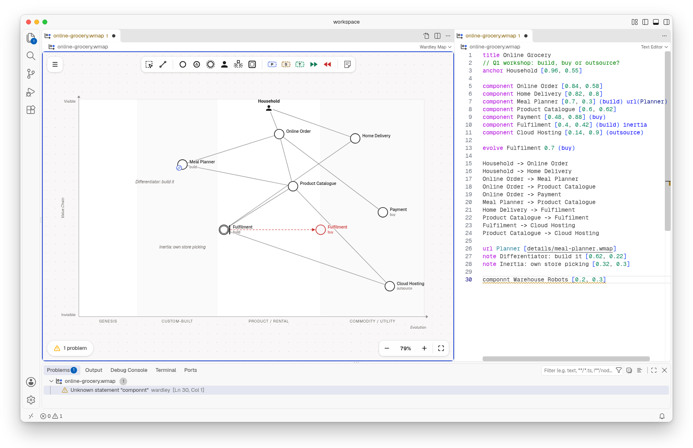

# Wardley Maps for VS Code

[](https://marketplace.visualstudio.com/items?itemName=miragon-gmbh.wardley-mapping-modeler)
[](https://github.com/Miragon/modeler-suite/blob/main/modelers/wardley-maps/LICENSE)



Draw [Wardley maps](https://learnwardleymapping.com/) on a canvas in VS Code. Each map is a
plain-text `.wmap` or `.owm` file in the [Online Wardley Maps](https://onlinewardleymaps.com/)
format, so it stays in your own repository and shows up in Git diffs line by line.

Free and open source (MIT). No account, no telemetry, and it works offline.

## Get started

1. Run **Wardley: New Map from Example** from the Command Palette (`Ctrl/Cmd+Shift+P`), or open any
   `.wmap` or `.owm` file. Maps from onlinewardleymaps.com open unchanged.
2. New to Wardley Mapping? A map places what your users need by how visible it is to them (up and
   down) and how mature it is, from genesis to commodity (left to right). The walkthrough **Get
   Started with Wardley Maps** shows you how to read and edit one.

## Draw on the canvas



Add components, users, notes and pipelines from the palette. Select an element to connect, evolve,
colour, link or delete it. Drag a component left or right to move it along evolution. Undo and save
work as for any other file.

## Export for slides



Export a map as PNG or SVG from the menu, or as a transparent PNG at four times the size for slides
and reports. The `.wmap` file stays the source you edit.

## Text and diagram side by side



**Wardley: Open Source to the Side** shows the map's text, with syntax highlighting, next to the
diagram. Type in the text and the diagram follows. Edit the diagram and the text changes, but only
the lines you touched: your comments, blank lines and order stay as you wrote them.



## Mistakes show up as problems



Lines the editor can't read are underlined and listed in the **Problems** view, and they stay in
the file as written. The diagram keeps drawing everything else.

## Your existing maps

Paste the text of a map from onlinewardleymaps.com into a `.owm` file:

```text
title Tea Shop
anchor Business [0.95, 0.63]
component Cup of Tea [0.79, 0.61]
component Kettle [0.43, 0.35]
evolve Kettle 0.62
Business -> Cup of Tea
```

Components, users, evolve, inertia, pipelines, submaps, notes and annotations are drawn on the
canvas. Anything else stays in the file as written and shows up in **Problems**.

## Link maps

**Link to map…** on a component or submap links it to another map in your workspace, and **Open
link** opens it. Links to maps that don't exist show up in **Problems**. When you rename or move
maps in VS Code, the extension offers to update the links.

## Maps written by an AI agent

A map is a text file, so a coding agent can write it, and the diagram redraws when the file
changes. For Claude Code, the `wardley-maps-modeler` plugin teaches the method and the format, so
you can ask Claude to draft a map from your strategy notes or to review one:

```text
/plugin marketplace add Miragon/modeler-suite
/plugin install wardley-maps-modeler@modeler-suite
```

## Good to know

- Needs VS Code 1.96 or later on the desktop. VS Code for the Web is not supported.
- There is no live co-editing. Share maps through Git, or open them in the
  [web app](https://wardley-maps.modeler.miragon.io), which makes share links.
- **Keyboard shortcuts…** in the editor's menu lists every key and gesture.
- The diagram stays light in dark themes.

## Links

[Changelog](https://github.com/Miragon/modeler-suite/blob/main/modelers/wardley-maps/apps/vscode/CHANGELOG.md)
·
[Report an issue](https://github.com/Miragon/modeler-suite/issues)
·
[Source and contributing](https://github.com/Miragon/modeler-suite/blob/main/modelers/wardley-maps/CONTRIBUTING.md)
·
[Third-party licences](https://github.com/Miragon/modeler-suite/blob/main/modelers/wardley-maps/apps/vscode/THIRD_PARTY_NOTICES.md)

Made by [Miragon](https://www.miragon.io). MIT licence.
