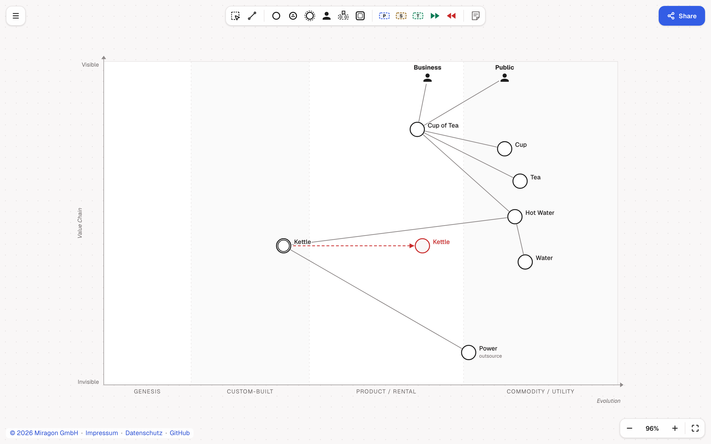

# Wardley Maps web app

[](https://github.com/Miragon/modeler-suite/blob/main/modelers/wardley-maps/LICENSE)

A browser editor for [Wardley Maps](https://learnwardleymapping.com/). Nothing to install: open `.wmap` / `.owm` / `.json` files (Open…, drop,
or paste OWM text or a share link), edit as OWM-DSL text, share the map as a link (it lives in the
URL hash) and export PNG, SVG, JSON or `.wmap`. Replacing the map can be undone; `?` lists the keys.

**[Live demo](https://wardley-maps.modeler.miragon.io)**



## Run locally

From the root of the Miragon modeler suite:

```bash
npm ci && npm run build:shared     # once
npm run wardley-maps dev:webapp         # named HTTPS URL via Portless; one-time setup in the suite's CONTRIBUTING.md
npm run wardley-maps dev:webapp:plain   # plain Vite, http://127.0.0.1:5180
```

## License

MIT
